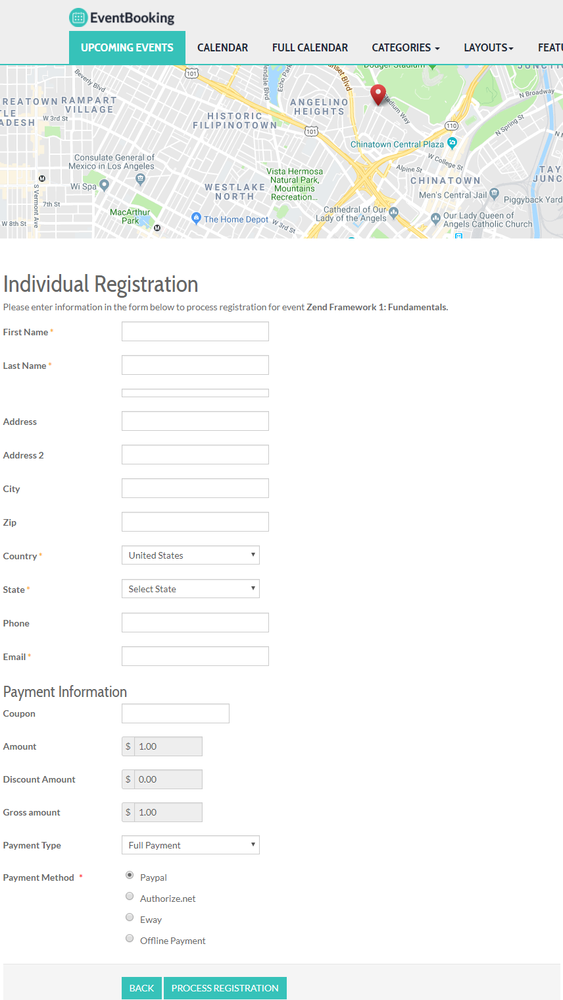
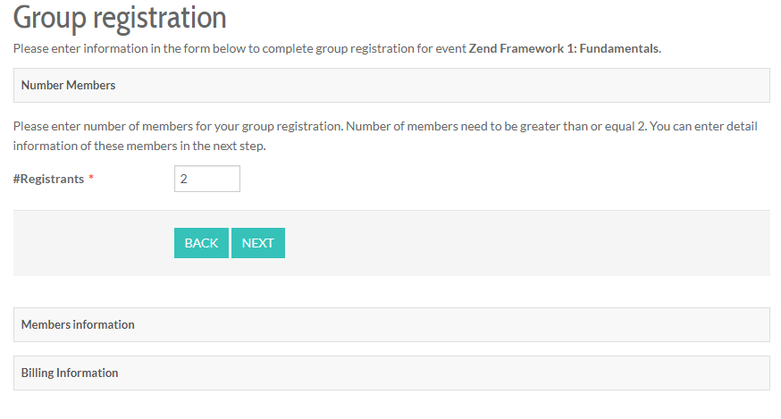
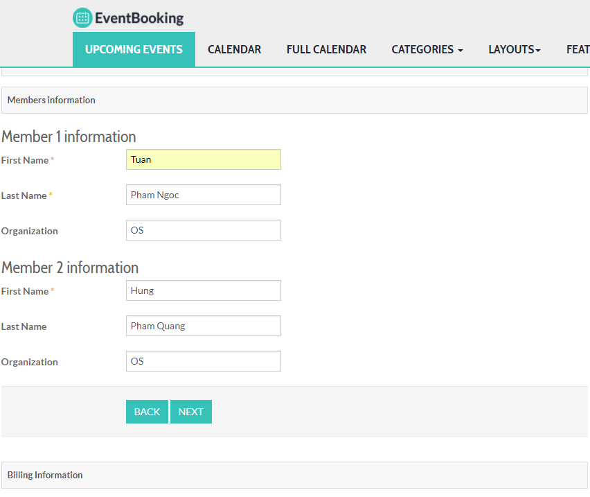
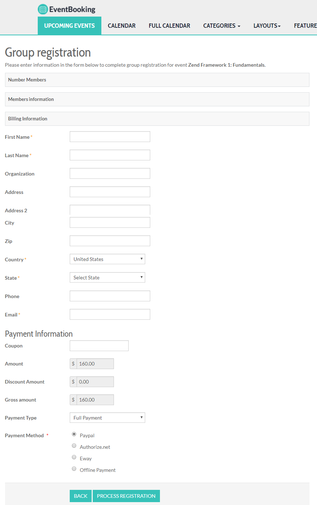

The **Registration Form** page lets visitors enter their details and pay if required to register for an event. There are two types of registration form.

## Individual Registration Form
Use this form to register one person. Visitors can open it using the Register (Individual) button on the events list or event details page, or from a menu item.

To give visitors a direct link to this page, create an **Events Booking** menu item of type **Individual Registration Form**. The settings below are specific to Events Booking.

- **Event**: Choose the event you want users to register for when they click on this menu item.

## Group Registration Form
The **group registration form** lets visitors register one or more people together. Visitors can open it using the Register (Group) button on the events list or event details page, or from a menu item.

To give visitors a direct link to this page, create an **Events Booking** menu item of type **Group Registration Form**. The settings below are specific to Events Booking.

- **Event**: Choose the event you want users to register for when they click on this menu item.

Group registration typically involves the following three steps.

1. Number Members
Enter the number of people to register.

2. Members Information
Enter the details of each group member.

3. Billing information
Enter the billing information, choose a payment method, and complete the registration.

## Customize Registration Form
The registration form in Events Booking is fully customizable.

1. **User registration integration**: If you want to allow your registrants to enter username and password to register for an account on your website when they register for your event, you can go to **Events Booking -> Configuration**, find the config option **User registration integration**, set it to **Yes**.
2. **Show/Hide, Require/Not require form fields**: If you want to make a field on registration form to be showed/hided or required/not required, please go to Events Booking -> Custom Fields, publish/unpublish or mark it as required/not required.
3. **Change title of the custom fields**: Sometimes, you might want to change title of the custom field (for example, change it from Organization to Company). In this case, just go to **Events Booking -> Custom Fields**, click on the custom field you want to change and edit it, change the title to suit your needs.
4. **Add more custom fields to registration form**: When you first install **Evens Booking**, the extension auto generate a list of pre-defined custom fields which we call Core Fields. They are **First Name, Last Name**......If you want to collect more information of registrants, you can go to **Events Booking -> Custom Fields** and create any extra custom fields you want. With custom fee field feature, you can even config it so that the registration price will be changed based on what options users choose on registration form.