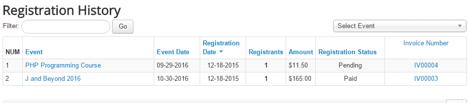
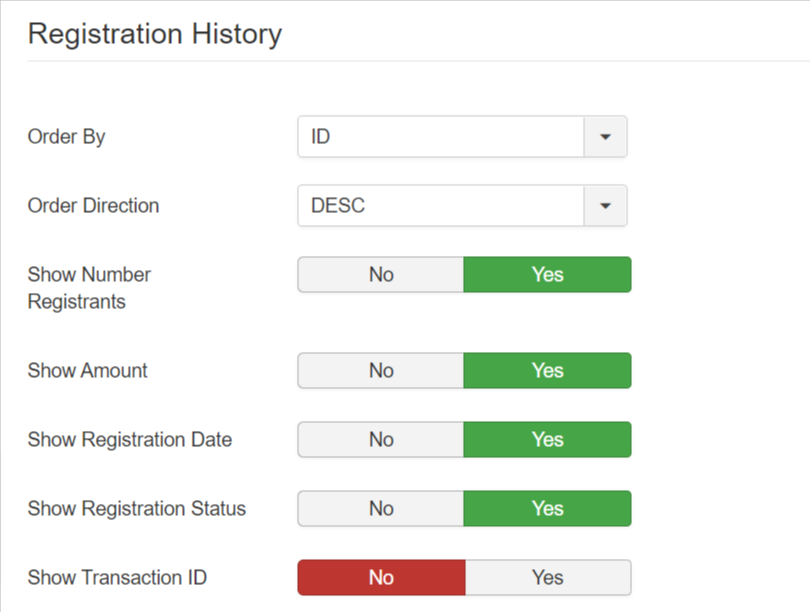

If registrants have accounts on your site, create an Events Booking menu item of type **Registration History**. Once they log in, registrants can open it to view their event registrations and download invoices.

## Customize Registration History
Go to **Events Booking** -> **Configuration**, open the **Themes** tab, and find **Registration History** to customize the display.

- Change the default order of registration records.
- Choose to show/hide some other columns (Number Registrants, Amount, Registration Date, Registration Status, Transaction ID).

For further customization, edit **components/com_eventbooking/themes/default/history/default.php**. Move the modified file to **PATH_TO_TEMPLATE/html/com_eventbooking/history** so extension updates preserve your changes.

