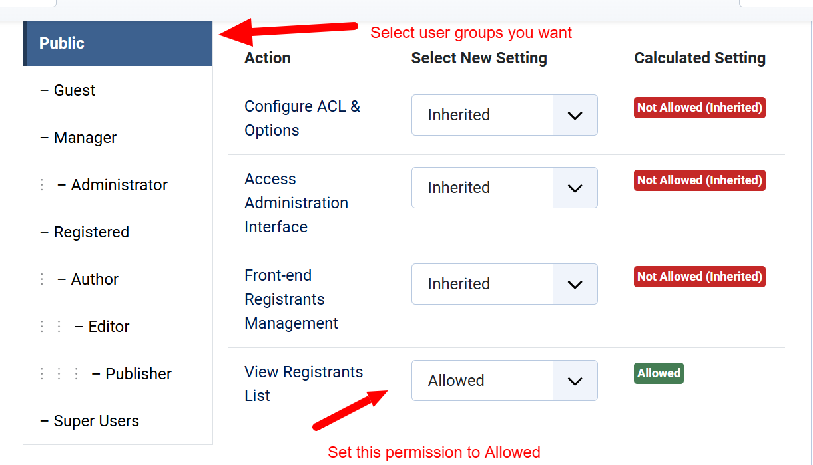
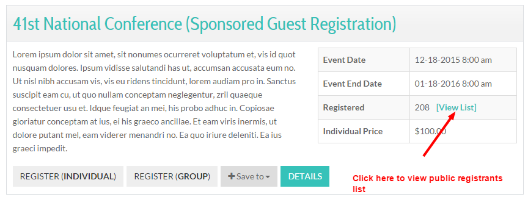

Follow these steps to display an event’s registrant list on the frontend.

## Enable viewing registrants list

1. Go to **Events Booking -> Configuration**, look at **Themes** tab, find the config option **Show List Of Registrants**, set it to **Yes**.
2. **Permission configuration**: Go to **Events Booking -> Configuration** or any Events Booking page in the administrator area. Click **Options** in the toolbar, select the user group, and set **View Registrant List** to **Allowed**. Joomla permissions are inherited. For example, if you grant this permission to **Public**, child groups such as Registered, Editor, and Publisher receive it too.

## Control what information is displayed on registrants list
Events Booking displays **First Name, Last Name, Number Registrants, Registration Date** by default. To show another field, go to Events Booking -> Custom Fields, edit the field, and set **Show On Public Registrants List** to Yes.

If you use group registration on your site, go to **Events Booking -> Configuration**, look at **Theme** tab, **Public Registrants List** section and change the following settings to suit your needs if needed:

- **Include Group Billing Records In Public Registrants List**: Set to Yes to display group billing records.
- **Include Group Members Records In Public Registrants List**: Set to Yes to display group member records.

From **Public Registrants List**, you can also choose to Show/Hide the following columns: **Registration Date**, **Ticket Type**, **Registration Status**.

## Sort Registrants List
Events Booking sorts the registrant list by **ID** in **Descending Order**, so the latest registrations appear first. To change the order, go to Events Booking -> Configuration, open the Themes tab, and find **Public Registrants List**.
- **Order By**: Here you can choose to order registrants list by ID or by any core custom fields like first_name, last_name, email.... If you want order by a custom field which you created (not a core field), you will need to use this tool [http://eventbookingdoc.joomservices.com/tools#make-field-sort-and-searchable](http://eventbookingdoc.joomservices.com/tools#make-field-sort-and-searchable) to make that field search and sortable first. After that, the field will be displayed to allow you to choose.
- **Order Direction**: ASC or DESC.

## How users can view registrants list of an event

1. **From events list and event details page**
When visitors browse your events, they can click **[View List]** next to the number of registered users to see who has registered for that event.

2. **From menu item**

To show registrants for a specific event, create an Events Booking menu item of type **Registrants list**. Choose the event in **Select Event**. Visitors can then open that menu item to see the list.

3. **At the bottom of event details page**

Go to Extensions -> Plugins and enable **Events Booking - Registrant list** to display the list at the bottom of the event details page.