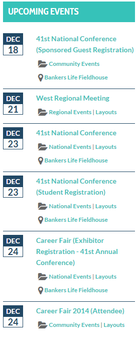
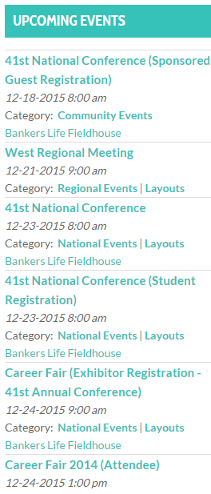
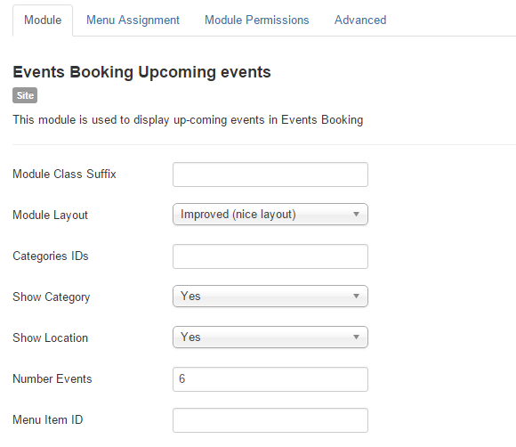

Use this module to display upcoming events. To use it, create an instance of **Events Booking - Upcoming Events** and publish it in a module position in your site template.

  
The module has the following parameters.
1. **Module Layout**: Choose how the module displays events. The options are **default**, **improved**, and **horizontal**.
2. **Categories IDs**: If you leave this parameter empty, events from all categories will be displayed. If you want to display events from certain categories, just enter the IDs of the categories you want into this parameter, comma separated. For example, if you enter **2,5**, events from categories with ID = 1 or ID = 5 will be displayed.
3. **Show Category**: Set to Yes to show each event’s categories.
4. **Show Location**: Set to Yes to show each event’s location.
5. **Number Events**: Enter how many events to display. The default is 6.
6. **Itemid**: Enter the ID of the menu item to use for SEF links to events in this module when Events Booking cannot find a matching menu item. Leave it blank to use the default menu item.

