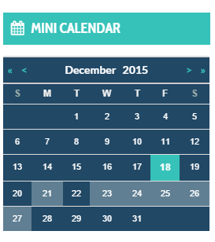

The mini calendar displays a month at a time. Visitors can browse by month or year and click a date to see its events and register. To use it, create an instance of **Events Booking - Mini Calendar** and publish it in a module position in your site template.

## Module parameters
- **Default Month**: Select the month to show initially. Visitors can then move to the next or previous month.
- **Select Category**: Choose the category you want to display events from. If no category is selected, events from all categories will be displayed.
- **Itemid**: Enter the ID of the menu item to use for SEF links to events in this module when Events Booking cannot find a matching menu item. Leave it blank to use the default menu item.