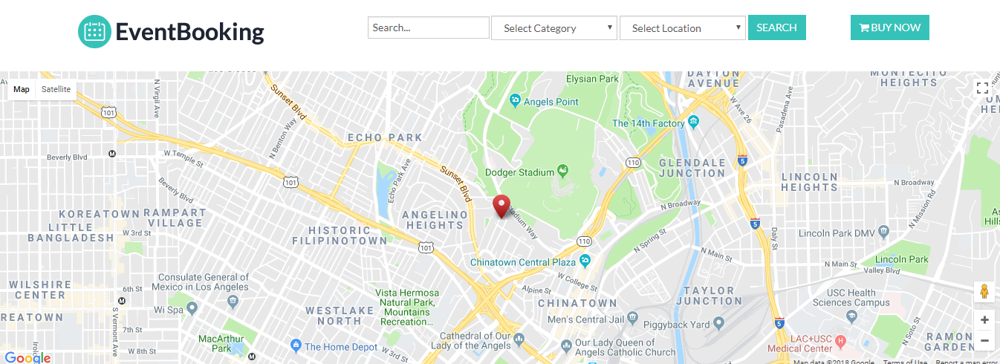

This module groups events by location on a Google Maps or OpenStreetMap map, depending on the Map Provider setting. To use it, create an instance of **Events Booking - Map** and publish it in a module position in your site template.

## Module parameters
- **Center Coordinates**: Set the map center. The default is the location of the first event.
- **Width**: Map width as a percentage.
- **Height**: Map height (in px).
- **Zoom level**: Zoom level of the map.
- **Max number events per location**: Set the maximum number of events to show when visitors click a location marker.
- **Select category**: Choose the categories to display events from. If no categories are selected, events from all categories will be displayed.
- **Select Locations**: Choose the locations to display events from. If no locations are selected, events from all locations will be displayed.
- **Hide past events**: Choose whether to show past events on the map.
- **Disable scrollwheel**: Set to Yes to disable mouse scroll-wheel scaling with Google Maps API.
- **Itemid**: Enter the ID of the menu item to use for SEF links to events in this module when Events Booking cannot find a matching menu item. Leave it blank to use the default menu item.