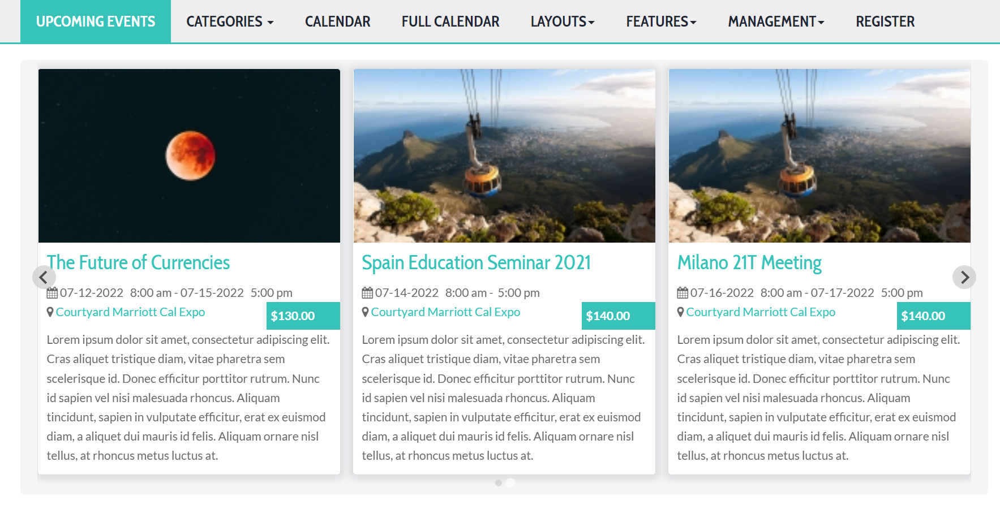

Use this module to display events in a slider. To use it, create an instance of **Events Booking - Events Slider** and publish it in a module position in your site template.

  
The module has the following parameters.

### Standard Parameters

1. **Display Event Type**: Choose **Upcoming Events**, **Past Events**, or **All**.
2. **Show Short Description**: Choose whether to show each event’s short description.
3. **Only Show Featured Events**: Set to Yes to show only events marked as Featured.
4. **Categories**: Select which categories to include. Leave this setting blank to include all categories.
5. **Locations**: Select which locations to include. Leave this setting blank to include all locations.
6. **Exclude Categories**: If you want to exclude events from certain categories from being displayed, select these categories in this parameter.
7. **Speakers**: Select speakers to display only events with those speakers.
8. **Show children events**: Choose whether to show child events in the module.
9. **Created By**: If you select a user in this parameter, only events created by this user will be displayed.
10. **Duration Filter**: Select the duration which you want to display events from (Today, Tomorrow....).
11. **Number Events**: Enter how many events to display. The default is 6.
12. **Order By**: Choose how to sort the events.
13. **Order Direction**: Choose ASC (ascending) or DESC (descending).
14. **Menu Item ID**: Enter the ID of the menu item to use for SEF links to events in this module when Events Booking cannot find a matching menu item. Leave it blank to use the default menu item.

## Slider Settings
1. **Theme**: Choose the theme you want to use for the slider.
2. **Arrows**: Choose whether to show navigation arrows.
3. **Pagination**: Choose whether to show pagination controls.
4. **Number Items**: Set how many slides are visible at once.
5. **Auto Play**: Choose whether the slider advances automatically.
6. **Speed**: Enter a larger number for faster movement.
7. **Gap**: Set the space between slides using a CSS value such as 1em.

## Reponsive Paramers

Set how many event slides are visible at different viewport widths.

- **Number Items Extra Small Viewport (less than 576px)**: Set how many slides to show on portrait phones.
- **Number Items Small Viewport (less than 768px)**: Set how many slides to show on landscape phones.
- **Number Items Medium Viewport (less than 992px)**: Set how many slides to show on tablets.
- **Number Items Large Viewport (less than 1200px)**: Set how many slides to show on desktops.

