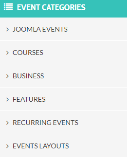

Visitors can select a category in this module to see its events. To use it, create an instance of **Events Booking - Event Categories** and publish it in a module position in your site template.

  
The module has the following parameters.
1. **Parent Category Id**: Enter a category ID to display only its subcategories. Leave it blank to display top-level categories.
2. **Number Categories**: Set how many categories to display.
3. **Itemid**: Enter the ID of the menu item to use for SEF links to categories in this module when Events Booking cannot find a matching menu item. Leave it blank to use the default menu item.