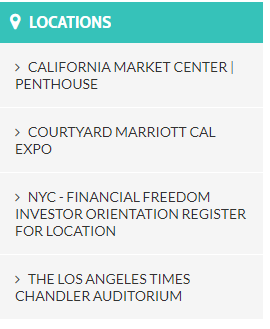

Visitors can select a location to see events there.

To use it, create an instance of **Events Booking - Events By Location** and publish it in a module position in your site template.

  
The module has the following parameters.
1. **Number Locations**: Set how many locations to display.
2. **Show number events**: Set to Yes to show the event count next to each location.
3. **Itemid**: Enter the ID of the menu item to use for SEF links to locations in this module when Events Booking cannot find a matching menu item. Leave it blank to use the default menu item.