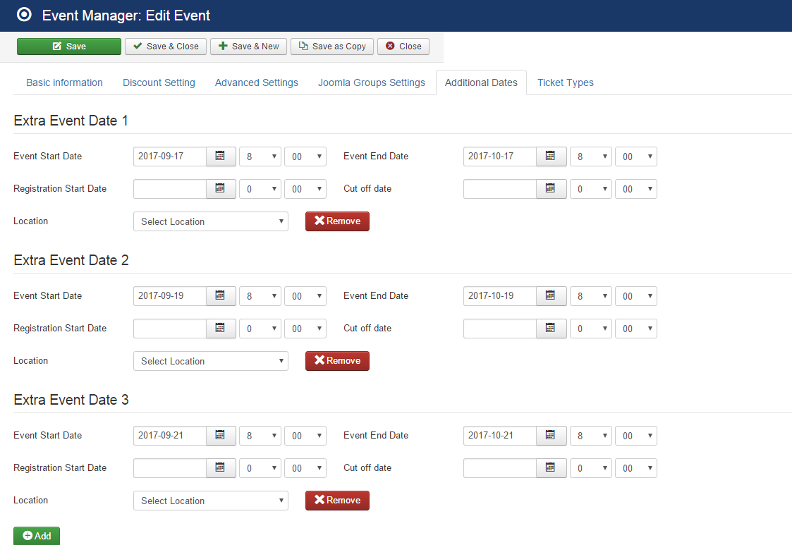

Add dates to an existing event without using Save As copy to create each event. The plugin works like recurring events, with dates you enter manually. See [http://joomdonationdemo.com/eventbooking/features/advanced-features/multiple-dates](http://joomdonationdemo.com/eventbooking/features/advanced-features/multiple-dates) for an example.

To add dates, follow these steps.
1. Go to Extensions -> Plugins Manager, find and publish the plugin **Events Booking - Additional Dates**
2. Now when you add, edit an event, there will be a new tab called **Additional Dates** to allow you to add more dates to the event 
3. If you want these additional dates to be displayed on event details page so that registrants can easy select the date they want to register like on this sample event ([http://joomdonationdemo.com/eventbooking/features/advanced-features/multiple-dates](http://joomdonationdemo.com/eventbooking/features/advanced-features/multiple-dates), go to Events Booking -> Configuration, find the config option **Show children events date under parent events**, set it to **Yes**
