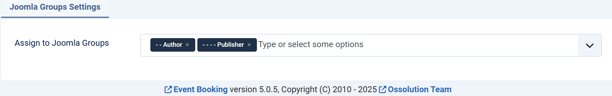

Assign registrants to the **Joomla user group(s)** you choose when they register for an event. You can then use Joomla access control to give those groups permission to perform certain actions or access restricted resources on your site.
1. Log in to the administrator area of your site as a super admin account.
2. Go to **System -> Plugins**, find and enable the **Events Booking - Joomla Groups** plugin.
3. When you add or edit an event, open **Joomla Groups Settings** and select the user groups. Events Booking assigns users to those groups when they register for the event.

Use Joomla’s access control settings to decide which resources those groups can access.

