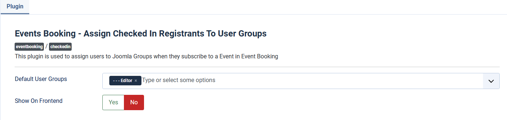
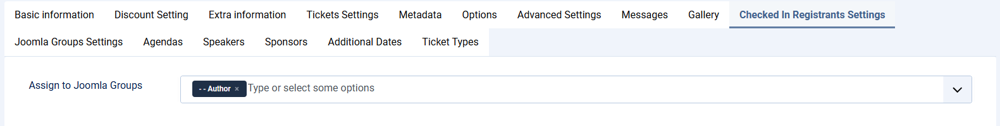

Use this plugin to assign registrants to selected user groups after check-in. You can then use Joomla access control to give those groups access to restricted resources.

- Go to **System** -> **Plugins**, find and enable this plugin **Events Booking - Assign Checked In Registrants To User Groups**
- This plugin has a parameter called **Default User Groups**. Set it to user groups you want and checked in registrants from all events, by default, will be assigned to these user groups unless you set it to different use groups inside the event

- If you need to assign checked in registrants of certain event to a different user groups (with default user groups above), you can edit that event, look at **Checked In Registrants Settings** tab, set **Assign to Joomla Groups** parameter to the user groups you want. It will override **Default User Groups** set in plugin parameters

