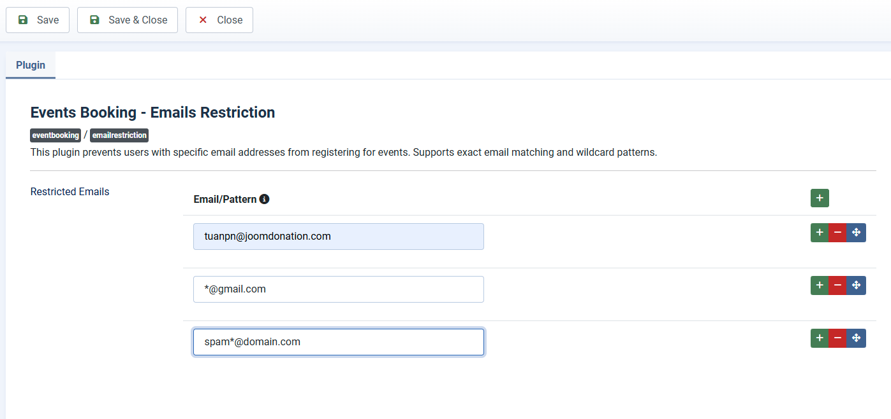

This plugin blocks registrations from specified email addresses. It supports exact addresses and wildcard patterns.

1. Log in to the administrator area of your site as a super admin account.
2. Go to **System -> Plugins**, find and enable the **Events Booking - Emails Restriction** plugin.
3. Open the plugin and configure the restrictions. Enter specific email addresses or use a wildcard to restrict all addresses from a domain.

