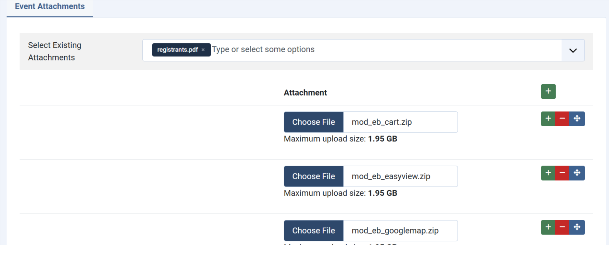

This plugin replaces the standard attachments field on the add and edit event forms so you can upload multiple attachments. Visitors can download the files from the event details page, or registrants can receive them with their registration confirmation email.

1. Go to System -> Plugins Manager, find and publish the plugin **Events Booking - Attachments**
2. When you add or edit an event, open **Event Attachments**. Select existing attachments or upload as many new ones as you need.

