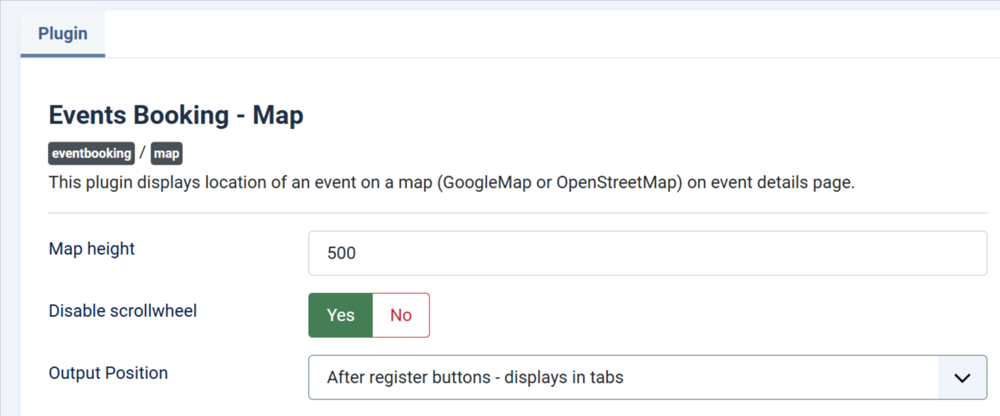

By default, visitors click the **Location Name** on the event details page to open a map in Google Maps.

To display a map directly on the event details page, go to **System -> Plugins** and enable **Events Booking - Map**. Adjust the following settings as needed.

- **Map Height**: Control height of the map.
- **Disable Scrollwheel**: Enable/Disable scroll-wheel.
- **Output Position**: Control where the map is displayed (before or after Register buttons).

