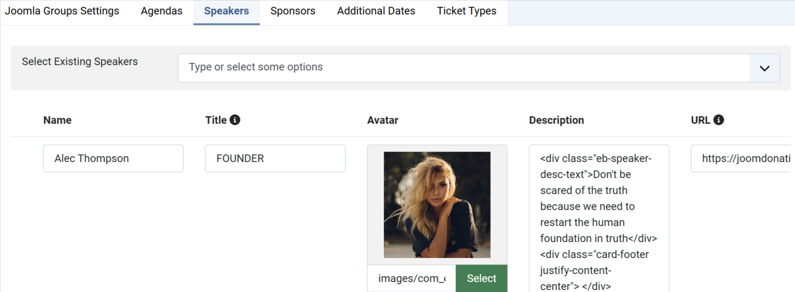
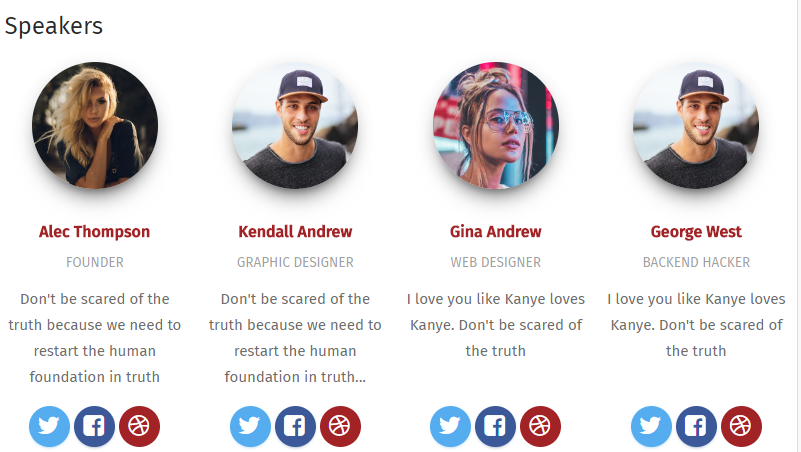

Use this plugin to add speakers to an event and display them on the event page. For an example, see the **Speakers** section at [https://demo.joomdonation.com/eventsbooking/features/advanced-features/agendas-speakers-sponsors](https://demo.joomdonation.com/eventsbooking/features/advanced-features/agendas-speakers-sponsors).

To use this feature:

1. Go to **System -> Plugins**, find and publish the plugin **Events Booking - Speakers**.
2. When you add or edit an event, open **Speakers** to add speakers for that event.
3. You can add any speakers you want for the event.

Please note that on demo site, you will see that each speaker has social icons displayed to allow linking to his personal social profile. If you want to have it displayed like that, you will have to use HTML code for description of each speaker. Below are sample:

```html
<div class="eb-speaker-desc-text">
Don't be scared of the truth because we need to restart the human foundation in truth
</div>
<div class="card-footer justify-content-center">
	<a href="#" class="btn btn-just-icon eb-btn-twitter btn-round"><i class="fa fa-twitter"></i></a>
	<a href="#" class="btn btn-just-icon eb-btn-facebook btn-round"><i class="fa fa-facebook"></i></a>
	<a href="#" class="btn btn-just-icon eb-btn-google btn-round"><i class="fa fa-google"></i></a>
</div>
```

You can use our build in css classes and font-awesome icons for these social buttons and icons:
1. Facebook: **eb-btn-facebook** and **fa fa-facebook**
2. Twitter: **eb-btn-twitter** and **fa fa-twitter**
3. Google: **eb-btn-google** and **fa fa-google**
4. Linkedin: **eb-btn-linkedin** and **fa fa-linkedin**
5. Pinterest: **btn-pinterest** and **fa fa-pinterest**



