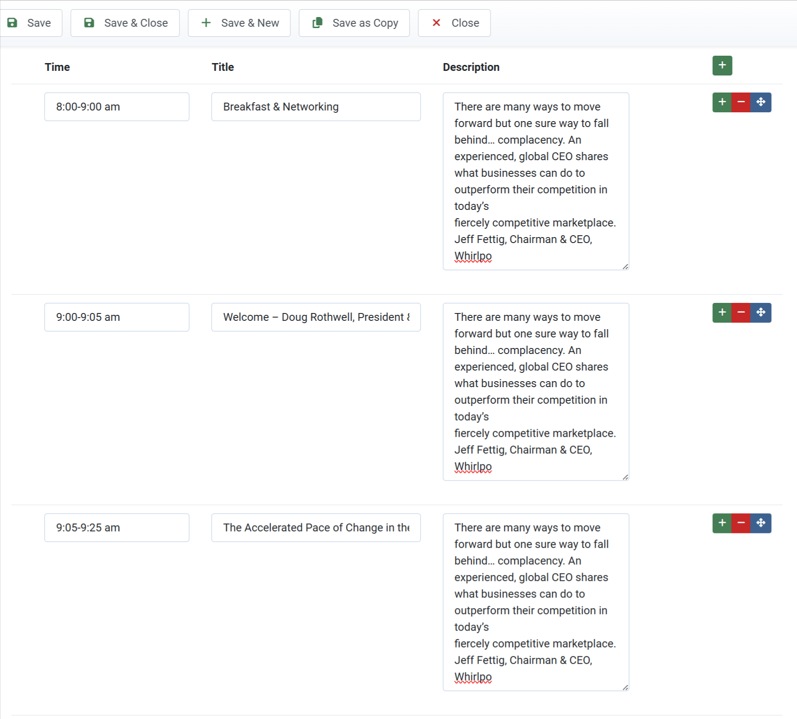

Use this plugin to add an agenda to an event and display it on the event page. For an example, see the **Agendas** section at [https://demo.joomdonation.com/eventsbooking/features/advanced-features/agendas-speakers-sponsors](https://demo.joomdonation.com/eventsbooking/features/advanced-features/agendas-speakers-sponsors).

To use this feature:

1. Go to **System -> Plugins Manager**, find and publish the plugin **Events Booking - Agendas**.
2. When you add or edit an event, open **Agendas** to set up the agenda. Events Booking displays it on the event details page.

