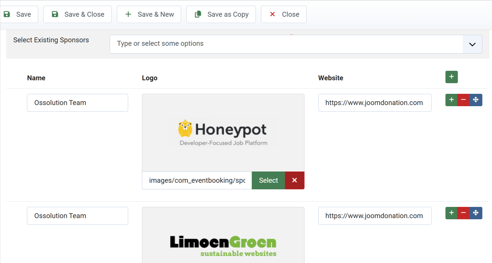

Use this plugin to add sponsors to an event and display them on the event page. For an example, see the **Sponsors** section at [https://demo.joomdonation.com/eventsbooking/features/advanced-features/agendas-speakers-sponsors](https://demo.joomdonation.com/eventsbooking/features/advanced-features/agendas-speakers-sponsors).

To use this feature:

1. Go to **System -> Plugins**, find and publish the plugin **Events Booking - Sponsors**.
2. When you add or edit an event, open **Sponsors** to add sponsors for that event.
3. Add any number of sponsors you want and it will be displayed in the frontend, on event detail page

