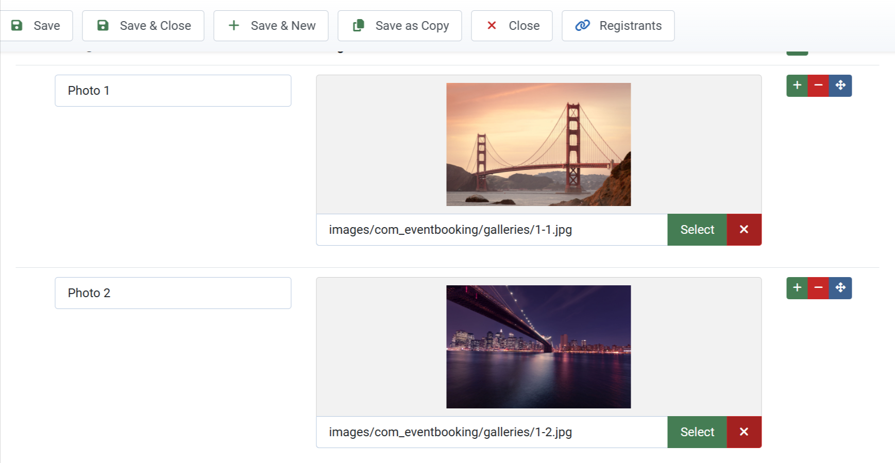
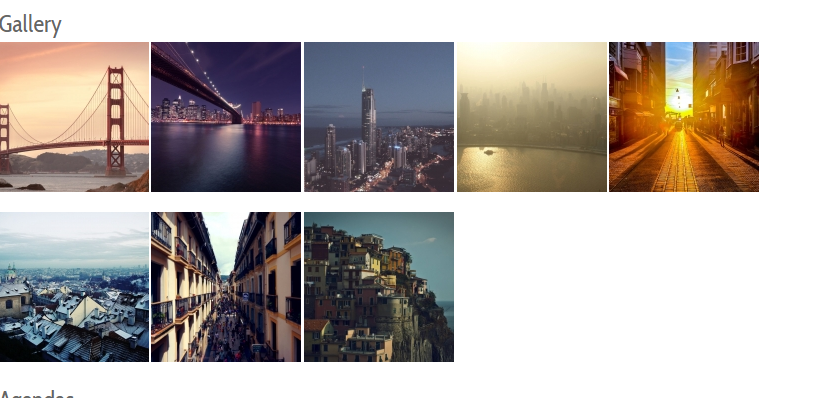

Use this plugin to add an image gallery to an event and display it on the event page. For an example, see the **Gallery** section at [https://demo.joomdonation.com/eventsbooking/features/advanced-features/gallery-plugin](https://demo.joomdonation.com/eventsbooking/features/advanced-features/gallery-plugin).

1. Go to **System -> Plugins**, find and enable the plugin **Events Booking - Gallery**. The plugin has some parameters which you should look at and change if needed:
- **Thumb Width**: Width of the generated thumbnail
- **Thumb Height**: Height of the generated thumbnail
- **Output Position**: Choose where you want the gallery to be displayed on event details page.
2. When you add or edit an event, open **Gallery** to add images. You can enter an optional description for each image.

3. The event page displays thumbnails in a gallery. Visitors can click a thumbnail to view the larger image and browse the other images.

