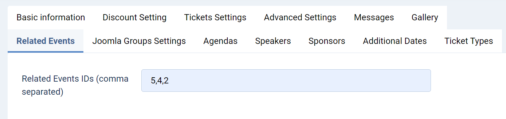
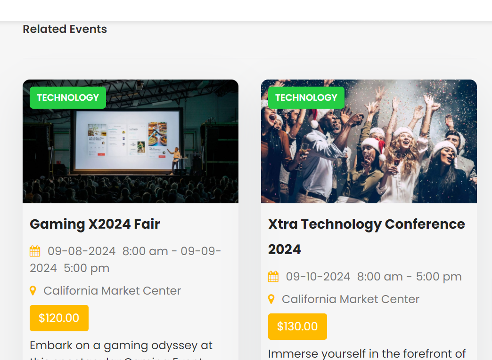

Link related events to a main event so visitors can find and register for them. To set up related events, follow these steps.

1. Go to Extensions -> Plugins Manager, find and enable the plugin **Events Booking - Related Events**
2. When you add or edit an event, open **Related Events** and enter the IDs of the events you want to link. Visitors will see them at the bottom of the main event page.

