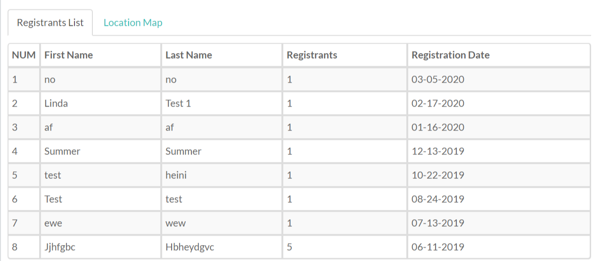

Display the registrant list on the event details page so visitors can see who is attending.

Go to Extensions -> Plugins and enable **Events Booking - Registrant List**. The registrant list appears on the event details page, as shown below.

