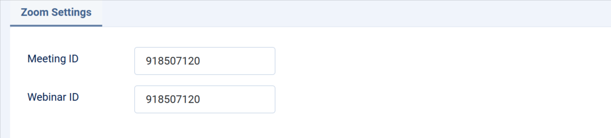

Automatically register event attendees for a Zoom meeting or webinar.

## Enable and Configure the plugin

1. Go to **System** -> **Plugins**, find and enable the plugin **Events Booking - Zoom App**
2. Follow instructions at [Create a Server-to-Server OAuth app](https://developers.zoom.us/docs/internal-apps/#create-a-server-to-server-oauth-app) , create a new Server-to-Server OAuth app. Note that in step **5**, you do not need to enable event subscriptions because we do not use webhooks for the integration. In step **6**, please enable all permissions for **Meeting** and **Webinar**.
3. Find the following parameters from the app which you created above: **Account ID**, **Client ID**, **Client Secret**, enter it into the **Events Booking - Zoom App** plugin parameters.
4. Now, when you add/edit an event, you will see a tab called Zoom Settings:
- If you want to add registrants of the event to a meeting, enter Meeting ID of that meeting into Meeting ID parameter.
- If you want to add registrants of the event to a webinar, enter Webinar ID of that meeting into Webinar ID parameter.

## Send Meeting/Webinar Information To Registrant
Use the following email tags to send meeting or webinar details to registrants.

[ZOOM_START_TIME] : Start time of the meeting/webinar

[ZOOM_JOIN_URL] : URL to join the meeting/webinar

[ZOOM_TOPIC] : Topic of the meeting/webinar

## Troubleshooting

Sometimes, when you added the tags above the email message, it is not being replaced properly with the actual zoom data. When that happens, please check and make sure the webinar/meeting you created have Registration Enabled. See:

[Scheduling a webinar with registration](https://support.zoom.com/hc/en/article?id=zm_kb&sysparm_article=KB0061631) and [Scheduling and customizing a meeting with registration](https://support.zoom.com/hc/en/article?id=zm_kb&sysparm_article=KB0065026) for detailed instructions

