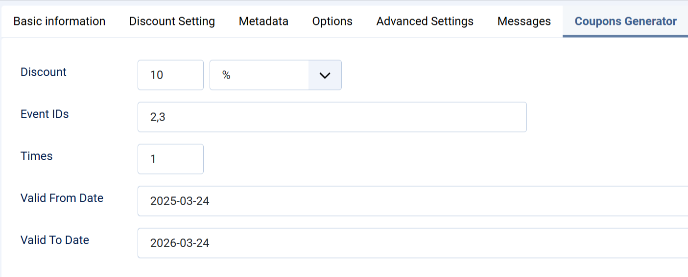

Generate and email a coupon code when users register for selected events. Registrants can use the code for a discount when they register for other events on your site.

## Enable and Configure the plugin

1. Go to **System** -> **Plugins**, find and enable the plugin **Events Booking - Auto Coupon Generation**
2. When you add or edit an event, open **Coupons Generator** to configure the coupon code that registrants will receive.

* **Discount**: Enter the discount for the coupon. Discount can be set to a fixed amount (for example 10$) or by percent (for example 10% of subscription fee).
* **Event IDs**: Enter IDs of the events which the coupon can be used for - comma separated. If you leave it empty, the generated coupon can be used for any events
* **Times**: How many times this coupon code can be used. Usually, it should be 1
* **Valid From Date**: If you choose a date, the coupon code can only be used from the selected date.
* **Valid To Date**: If you chose a date, the coupon code can only be used before the selected date. After that date, the coupon code cannot be used anymore.

## How the generated coupon can be sent to registrant
With above setup, when users register and paid for the registration, the coupon code will be genreated and send to them via email:
* If you use [REGISTRATION_DETAIL] tag, the coupon code will be part of that tag
* You can also insert the tag [AUTO_COUPON_CODE] to show that coupon code in the email sent to registrant