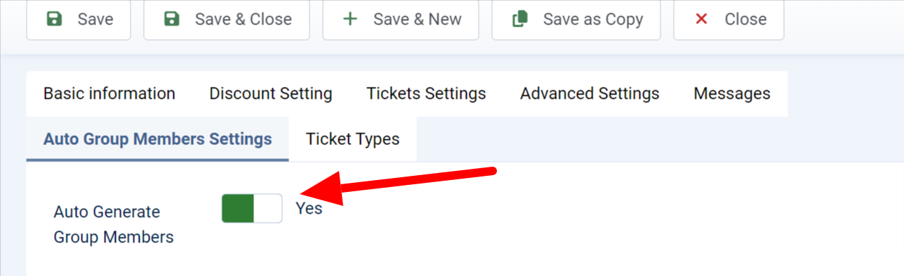

This plugin automatically generates group members without asking the person completing the registration to enter details for each member. Use it with the Tickets PDF feature to generate separate PDF tickets without collecting individual member information.

1. Go to System -> Plugins, find and enable the plugin **Events Booking - Auto Group Members Generator**
2. When you add or edit an event, open **Auto Group Members Settings**. Set **Auto Generate Group Members** to Yes to generate group members automatically for registrations.

Now, when someone performs group registration for that event, even you do not require them to enter members information, members records will be generated automatically by the system, thus separate PDF tickets will be generated and make it easier to distribute these tickets to members of the group

