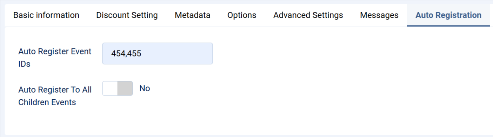
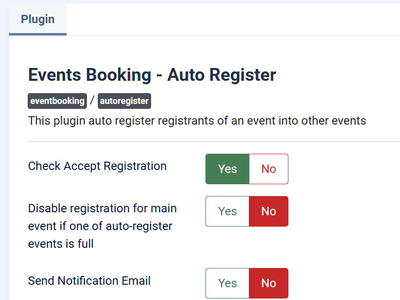

When someone registers for an event, this plugin can automatically register them for other events you choose or for all the child events of that event.

1. Go to **System** -> **Plugins**, find and publish the plugin **Events Booking - Auto Register**
2. When you add or edit an event, open **Auto Registration** to configure the following settings.

* **Auto register Event Ids**: Enter the IDs of the events separated by commas. When someone registers for this event, the plugin also registers them for the events you enter.
* **Auto Register To All Children Events**: Set to **Yes** to register people for all child events when they register for the parent event. You can create child events through recurring events or the additional dates plugin.

### Plugin Parameters

Adjust the following plugin settings as needed.

- **Check Accept Registration**: By default, the plugin registers users only for events that still accept registrations. To register users through the main event even when direct registration for the other events is disabled, set this option to **No**.
- **Disable registration for main event if one of auto-register events is full**: If set to Yes and the configured auto-register events are full, the registration for the main event will be disabled.
- **Send Notification Email**: Set to Yes to email the registrant about each automatic registration.

