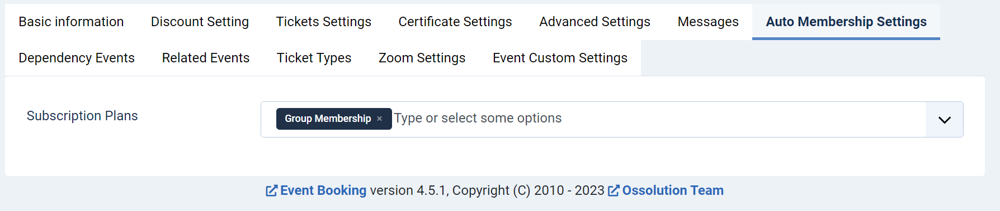

Subscribe users to selected plans in **Membership Pro** when they register for your event.

1. Go to **System** -> **Plugins**, find and enable the plugin **Events Booking - Auto Membership**
2. When you add or edit an event, open **Auto Membership Settings** and choose the subscription plans.
3. You also need to map the fields between the two extensions. See [https://docs.joomdonation.com/eventsbooking/basic-setup/synchronize-profile-data#membership-pro](https://docs.joomdonation.com/eventsbooking/basic-setup/synchronize-profile-data#membership-pro) for instructions

After that, when someone registers for the event, they will be subscribed to the subscription plans you selected above

