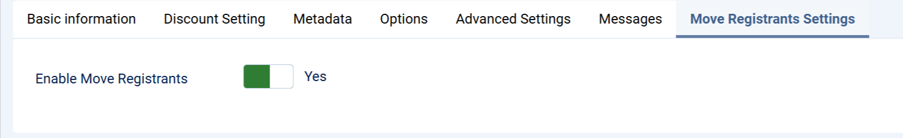
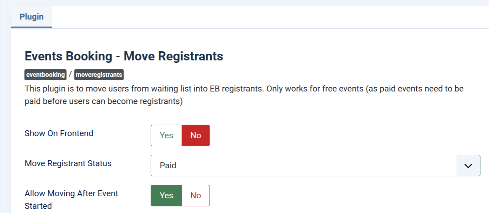

When you enable the **Waiting List** feature, users can join the waiting list for a full event. They appear in Registrants Management with the **Waiting List** status.

Use this plugin to move people from the waiting list into registration automatically when someone cancels. People who joined the list earliest have priority.

Just go to **System** -> **Plugins**, find and enable the plugin **Events Booking - Move Registrants** to use this feature. Now when you add/edit an event, you will see a new tab called **Move Registrants Settings** allow you to enable this feature for the event.

### Plugin Parameters

- **Move Registrant Status**: Control the status of of the registration when it is being moved from waiting list to be registrant. By default, registrant will have **Paid** status but you can change this to **Pending** if needed
- **Allow Moving After Event Started**: By default, the system will move users from waiting list to Registrant whenever there is someone cancel their registration. But if you do not want this happens when the event is already started, you can set this parameter to **No**

