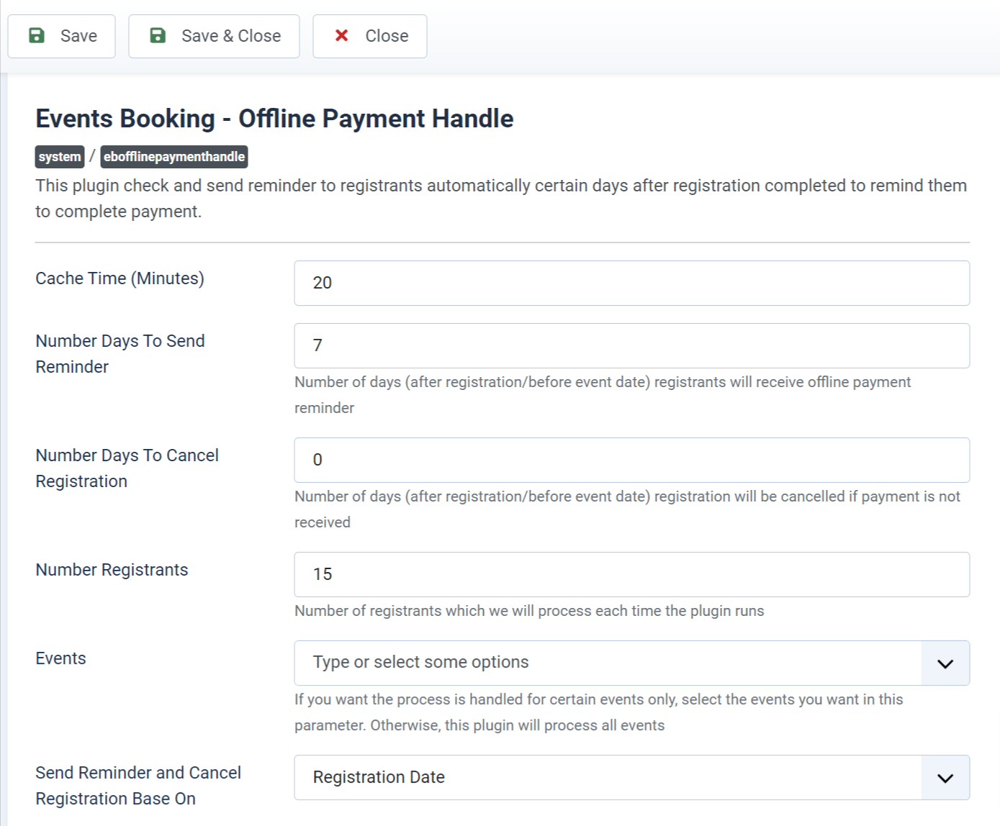

>>> This plugin was removed from version 5.0.7. Please use **[Events Booking - Offline Payment Handle](/scheduled-tasks/offline-payment-handle)** scheduled task instead.

This plugin handled the following tasks.
1. Send reminders email to registrants who haven't made payment for their **offline payment registrations**  to ask them to make payment.
2. Cancel offline payment registrations if payment is not made certain number of days after registration (or before event started).

## Configure The Plugin
Go to **System -> Plugins** and enable **System - Events Booking Offline Payment Handle**. Adjust the following settings as needed.

- **Cache Time (Minutes)**: Determine how often the plugin should be run to process sending reminder and cancel registration. Set to 20 minutes for example and it will be run every 20 minutes. During testing, you might want to set **Cache Time** to 0 and it will be run whenever someone access to a page on your site.
- **Number Days To Send Reminder**: Number of days (after registration/before event date) registrants will receive offline payment reminder if they haven't made payment. If you don't want reminder emails to be set, set it to 0.
- **Number Days To Cancel Registration**: Number of days (after registration/before event date) registration will be cancelled if payment is not received.
- **Send Reminder and Cancel Registration Base On**: Determine the plugin should send reminder and cancel registration base on Registration Date (X days after registration) or before Event Date (X days before registration)
- **Number Registrants**: Number of registrants which we will process each time the plugin runs.
- **Events**: If you want the process is handled for certain events only, select the events you want in this parameter. Otherwise, this plugin will process all events.

