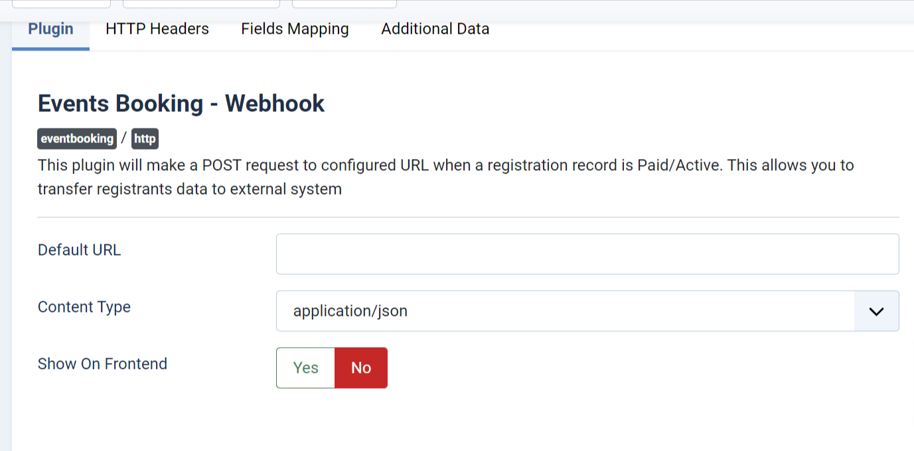
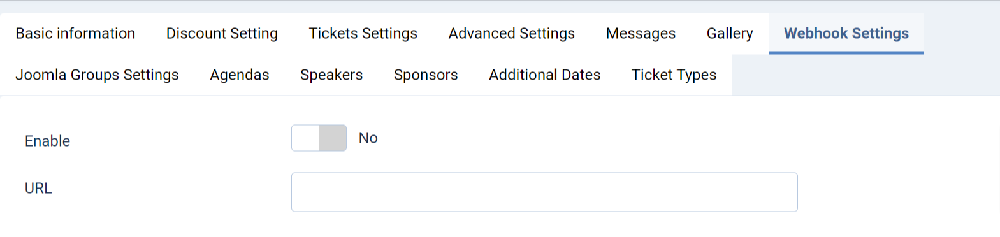

This plugin sends registration and event data to an external URL in a POST request when a new registration record reaches Published/Paid status. The receiving system can then use the data.

To use the webhook, find **Events Booking - Webhook**, configure the required settings, and enable it.

## Plugin Parameters

**- Default URL** : That's the default external URL which will receive data sends from Events Booking. Each event can override this default URL if needed.
**- Content Type**: Determine the how the format of data which will be passed to external system. If you choose **application/json**, the external URL will receive data in JSON format. If you choose **application/x-www-form-urlencoded**, the data will be passed in key-value pair (array)

**HTTP Headers**: Allows you to define additional HTTP headers which will be sent in the request (beside the content type header above). Usually, you will need it to pass authentication header so that the external system will allow/except the request.

**Fields Mapping**: If the external system which you want to pass data to expects to receive difference field with the field passed by the plugin, define the field mapping here (kind of field name alias). For example, the plugin pass **first_name** by default, but your system expect to receive **firstname**, you can add a mapping first_name => firstname

**Additional Data**: Allows you to define the extra data (key and it's value) which will be passed to the external URL if needed.

## Enable Webhook for each event
By default, webhook is disabled for all events. If you want to enable it for your event, edit the event, look at Webhook Settings tab, set **Enable**  to Yes. Optional, you could also specify URL which will receive webhook data into **URL** inside that event. If the URL is entered there, it will override the default URL configured in the plugin parameter.

## The data sent by the plugin to external URL

When enabled, the plugin will send many data related to that configured URL in a post request. Below are the information of the data which the external system will receive

### Registration Record Data

**-Data for any custom fields collected on registration form** 

- first_name
- last_name
- organization
- address
- city
- state
...
- custom_field_1
- custom_field_2
.....

**- Other registration related data**
- id
- event_id
- user_id
- group_id
- number_registrants
- total_amount
- discount_amount
- tax_amount
- payment_processing_fee
- amount
- register_date
- payment_date
- payment_method
- transaction_id
- published
- language
- ticket_number
- invoice_number
- tax_rate
- formatted_invoice_number
- coupon_id
- register_date_formatted
- registration_cancel_date_formatted
- ticket_number_formatted
- payment_method_name
- country_code
- username
- coupon_code

**- Formatted about fields with currency included**
- total_amount_with_current_formatted
- discount_amount_with_current_formatted
- tax_amount_with_current_formatted
- payment_processing_fee_with_current_formatted
- amount_with_current_formatted

**- Formatted amount fields without currency**
- total_amount_formatted
- discount_amount_formatted
- tax_amount_formatted
- payment_processing_fee_formatted
- amount_formatted

### Event Data
- short_description
- description
- event_id
- event_title
- alias
- price_text
- event_date
- event_date_date
- event_date_time
- event_day
- event_month
- event_year
- event_month_short
- event_month_number
- event_end_date
- event_end_date_date
- event_end_date_time
- enable_cancel_registration
- cancel_before_date
- cut_off_date
- event_capacity
- available_place
- individual_price
- location_name_address
- location_name
- location_city
- location_state
- location_address
- location_description
- location_image
- Any event custom fields can be accessed using NAME_OF_FIELD_IN_UPPERCASE_SYNTAX
- speakers
- main_category_name
- main_category_description
- main_category_id
- category_name
- event_creator_name
- event_creator_username
- event_creator_email
- event_creator_id