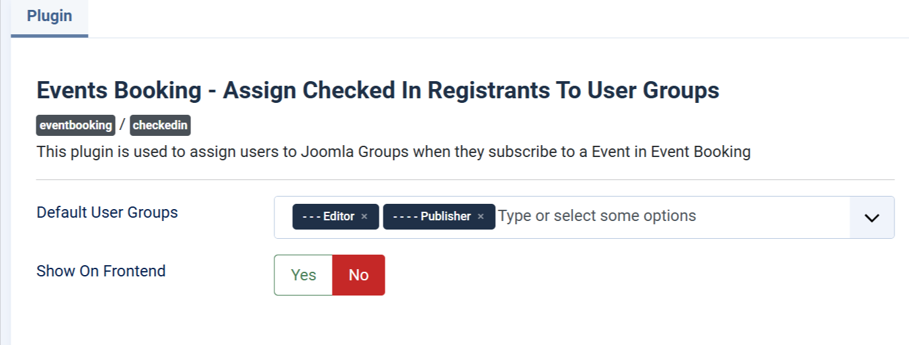
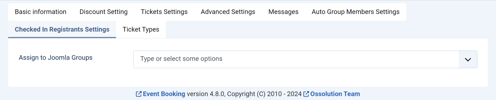

Assign registrants to selected user groups after check-in. You can use those groups to grant access to restricted resources on your site.

1. Go to **System** -> **Plugins**, find the plugin **Events Booking - Assign Checked In Registrants To User Groups**, click on it to edit.
2. The plugin has a parameter called **Default User Groups**. If you select the user groups here, checked in registrants of all events will be assigned to these default user groups.
3. Enable the plugin.
4. If you want checked in registrants from certain event to be assigned to different user groups with default user groups above, you can edit the event, look at **Checked In Registrants Settings** tab, and choose the user groups from there. It will override (has priority) with the user groups you select in the **Default User Groups** parameter inside the plugin.

