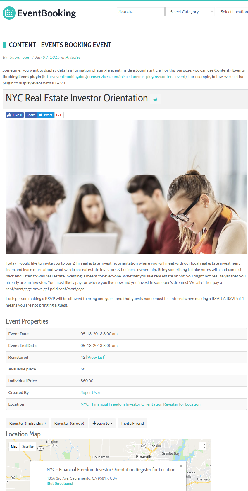

Display the details of an event in a Joomla article or another page that runs Joomla content plugins, such as a K2 item. See [https://demo.joomdonation.com/eventsbooking/features/other-features/event-in-article](https://demo.joomdonation.com/eventsbooking/features/other-features/event-in-article) for an example.

To use this plugin, follow these steps.
1. Go to **System** -> **Plugins**, find and enable the plugin **Content - Events Booking Event**
2. Edit the article you want to display this event, enter this syntax **{ebevent ID_OF_EVENT}**. **ID_OF_EVENT** needs to be replaced with ID of the event you want to display, for example **{ebevent 1}** will display event with ID = 1 in the article.

