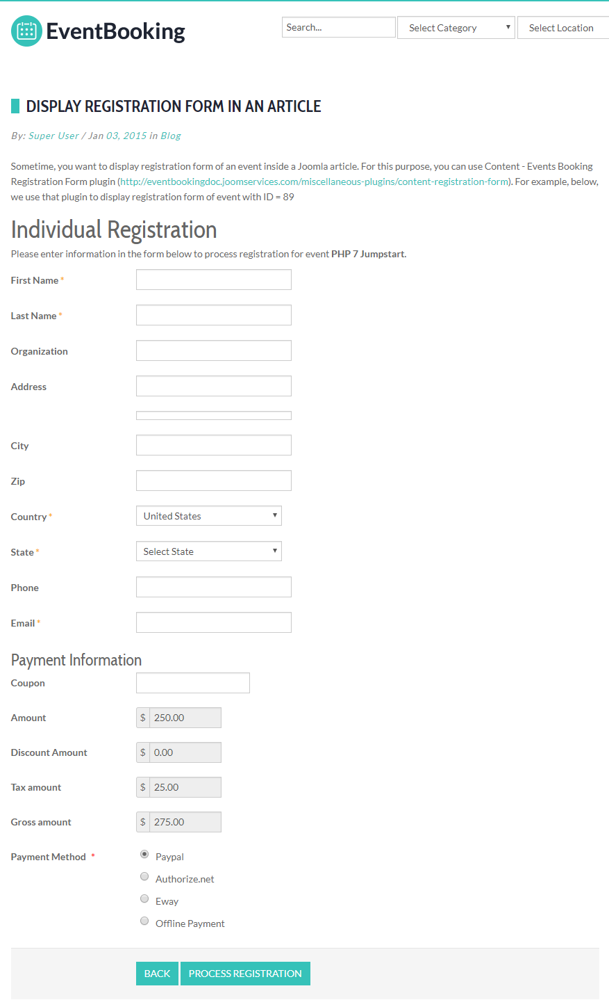

Display an event’s Individual Registration Form in a Joomla article or another page that runs Joomla content plugins, such as a K2 item. See [https://demo.joomdonation.com/eventsbooking/features/other-features/content-registration-form](https://demo.joomdonation.com/eventsbooking/features/other-features/content-registration-form) for an example.

To use this plugin, follow these steps.

1. Go to **System** -> **Plugins**, find and enable the plugin **Content - Events Booking Registration Form**
2. Edit the article you want to display registration form, enter **{ebregister ID_OF_EVENT}**. **ID_OF_EVENT** needs to be replaced with ID of the event you want to users to register for when accessing to this article, for example **{ebevent 1}** will display registration form of event with ID = 1 in the article.

