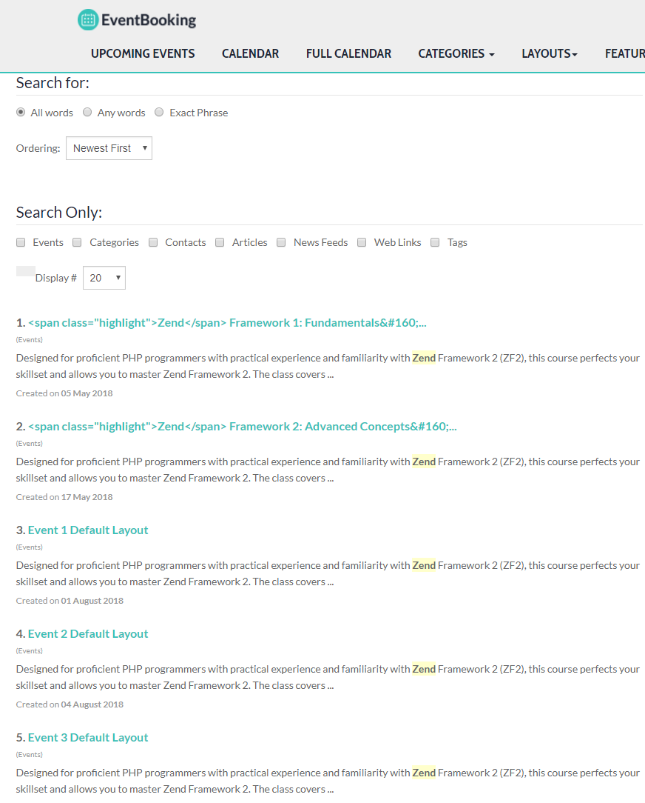

Let visitors find events through the Joomla search module. Go to System -> **Plugins** and enable **Search - Events Booking**.

Now, when users try to use Joomla search module or search component to search for content, the matching events will be displayed in search results. Users can also be able to choose search for events only from that search form!

