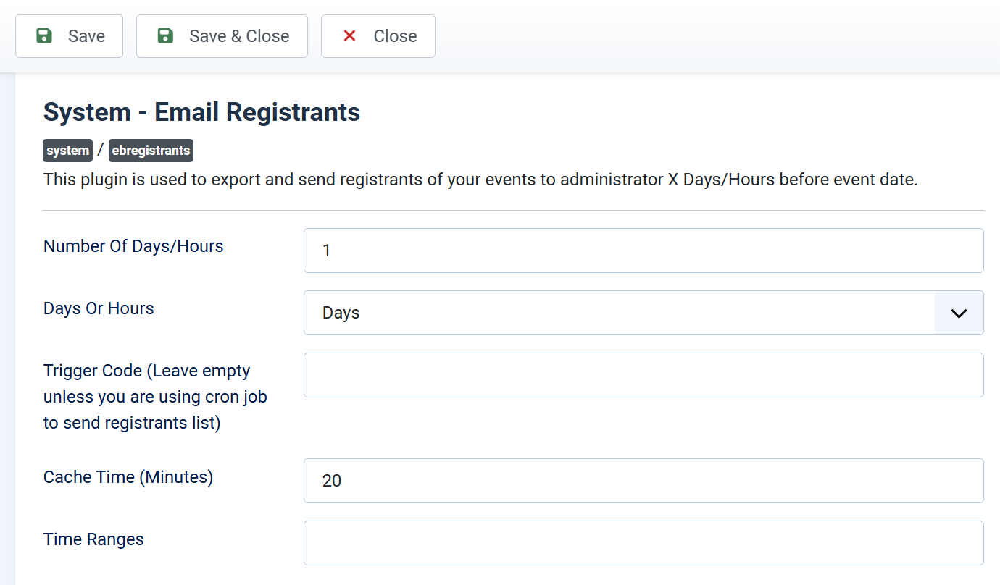
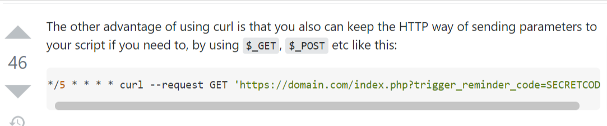

>>> This plugin was removed from version 5.0.7. Please use **[Events Booking - Email Registrants List](/scheduled-tasks/email-registrants-list)** scheduled task instead.

This plugin automatically emails a registrant list in CSV or Excel format to the administrator and the event creator or owner a set number of days or hours before an event starts.

## Configure The Plugin
Go to **System -> Plugins** and enable **System - Email Registrants**. By default, the plugin checks every 20 minutes whether it needs to email a registrant list. You can change the interval and the other settings below.

- **Number Of Days/Hours**: Enter Number Of Days/Hours **before Event Date** the system will prepare registrants list in Excel/CSV file and send it to administrators.
- **Days Or Hours**: Together with **Number Of Days/Hours** parameter, it will control how many days (if this parameter set to **Days**) or hours (if this parameter set to **Hours**) before event date, the registrants list will be emailed.

## Configure Email Subject and Email Body

Go to Events Booking -> Emails & Messages, find the two items below and change it to suit your needs if needed:

- **Send Registrants List Email Subject**
- **Send Registrants List Email Body**

You can use any tags listed in this page [Event Information Tags](/email-tags/common-tags#event-information-tags) to include event information in the email message. You can also use [TOTAL_REGISTRANTS] tag to show total number registrants of the event in the email.

## Use Cron Job
By default, Events Booking uses a system plugin to trigger sending registrants emails process. That mean it requires someone access to the site (search engine bots are also counted) to trigger process. Sometimes, it is not reliable or causes multiple  emails sent to administrators in case your site has a very high traffic. To address that limitation, you can set up cron job from your hosting account to trigger sending registrants instead. Please see detailed instructions below:

1. Go to **System** -> **Plugins**, find the plugin **System - Email Registrants** , click on it to edit. You should see a  parameter called **Trigger Code** . Enter a secret string there.

2. Setup a cron job to make a request to this URL using CURL (note that you should use the CURL so that the variable can be passed in the GET request, see [https://stackoverflow.com/questions/11375260/cron-command-to-run-url-address-every-5-minutes](https://stackoverflow.com/questions/11375260/cron-command-to-run-url-address-every-5-minutes) for detailed instructions

**https://domain.com/index.php?trigger_code=SECRETCODE**

- Replace **https://domain.com/** with URL of your site
- Replace **SECRETCODE** with the secret string which you entered in the **Trigger Code** parameter

That will make the reminder only processed when there is a request made to that URL (which should be secret as no real users will access to that URL). It will make it more reliable compare to replying a system plugin.

## Control the time registrants sent
If you want the registrants sent at a certain time in the day only (in the Time Zone configured in **Website Time Zone** config option in **System -> Global Configuration** of your site), you can use **Time Ranges** parameter inside the plugin. For example, set it to** 5,14** will make the system only send registrants  from **5am to 2pm**. Set it to **8,10;14:18** will allow sending  registrants between **8 to 10 am and 2pm to 6pm**.
