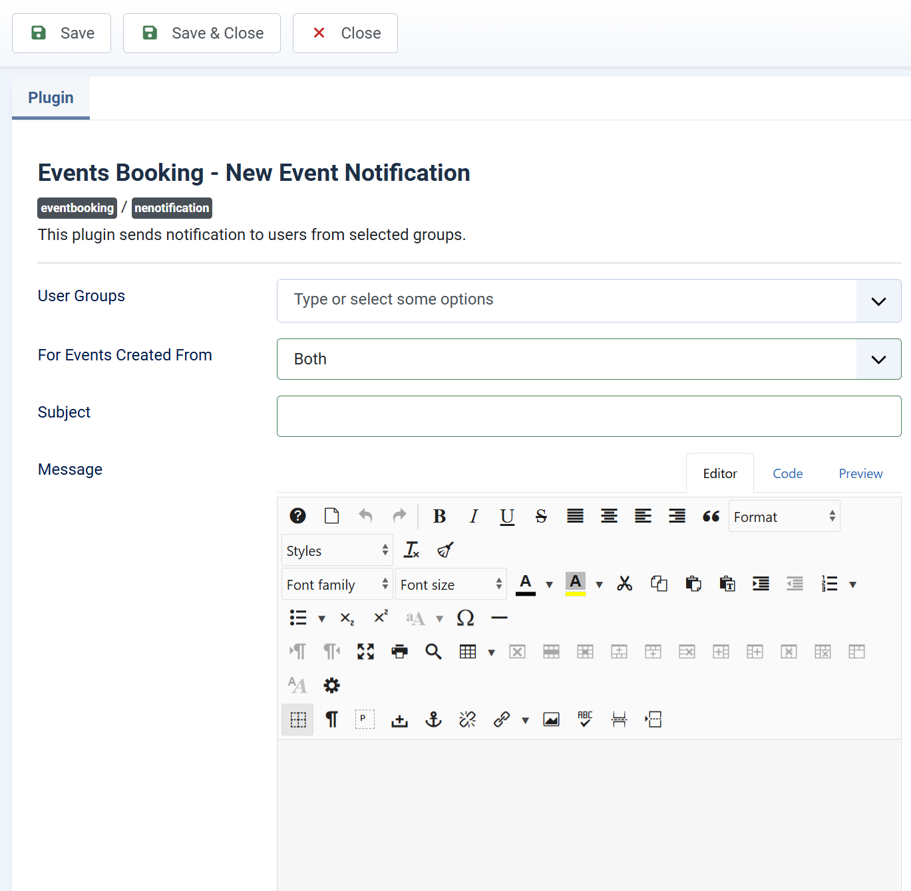

Notify members of selected user groups when someone creates an event. Choose whether to send notifications for events created on the frontend, in the administrator area, or in both places.

## Configure The Plugin
Go to **System -> Plugins** and publish **Events Booking - New Event Notification**. Adjust the following settings as needed.

- **User Groups**: Select the user groups which you want to send notification email to each time there is new event created.
- **For Events Created From**: Determine whether the notification emails should be sent when events created from frontend, backend or both.
- **Subject**: Subject of the notification email.
- **Message**: Message of the notification email.

## Supported Tags
You can use the following tags in the subject and message of the emails:

- [Event Information Tags](/email-tags/common-tags#event-information-tags)
- [Category Information Tags](/email-tags/common-tags#category-information)
- [Event Creator Information Tags](/email-tags/common-tags#event-creator-information)
- [Event Custom Fields Tag](/email-tags/common-tags#event-custom-fields-information) (only if you use event custom field)
- Some tags relates to the user who is receiving the email:

+ [USER_ID]
+ [USERNAME]
+ [NAME]
+ [EMAIL]

