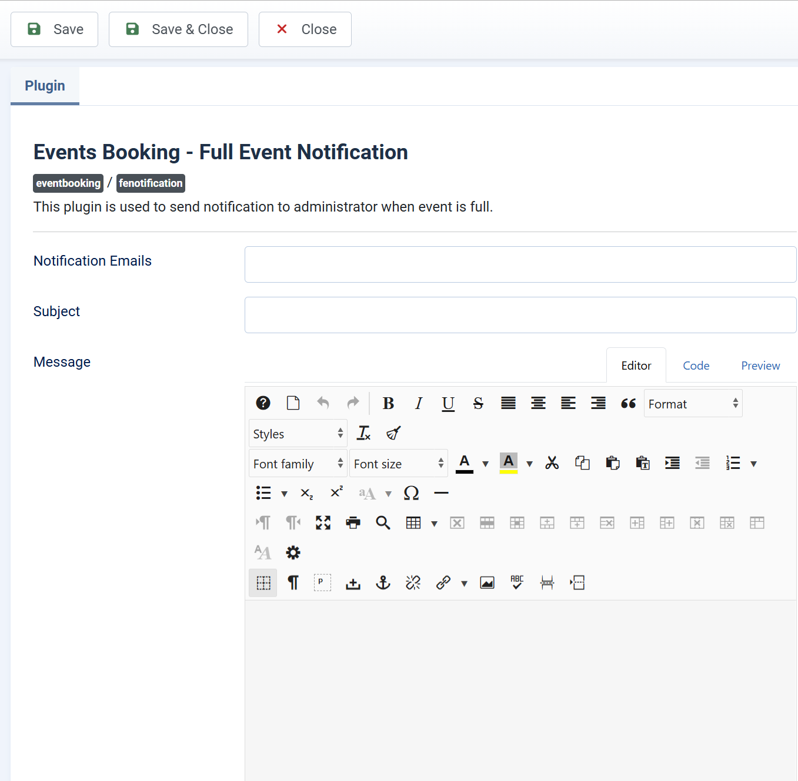

Notify selected recipients, typically administrators, when an event is full.

## Configure The Plugin
Go to **Extensions -> Plugins** and enable **Events Booking - Full Event Notification**. Adjust the following settings as needed.

- **Notification Emails**: Enter emails you want to receive a notification, comma separated. For example email1@domain.com,email2@domain.com.
- **Subject**: Subject of the notification email.
- **Message**: Message of the notification email.

## Supported Tags
You can use the following tags in the subject and message of the emails:

- [Event Information Tags](/email-tags/common-tags#event-information-tags)
- [Category Information Tags](/email-tags/common-tags#category-information)
- [Event Creator Information Tags](/email-tags/common-tags#event-creator-information)
- [Event Custom Fields Tag](/email-tags/common-tags#event-custom-fields-information) (only if you use event custom field)

