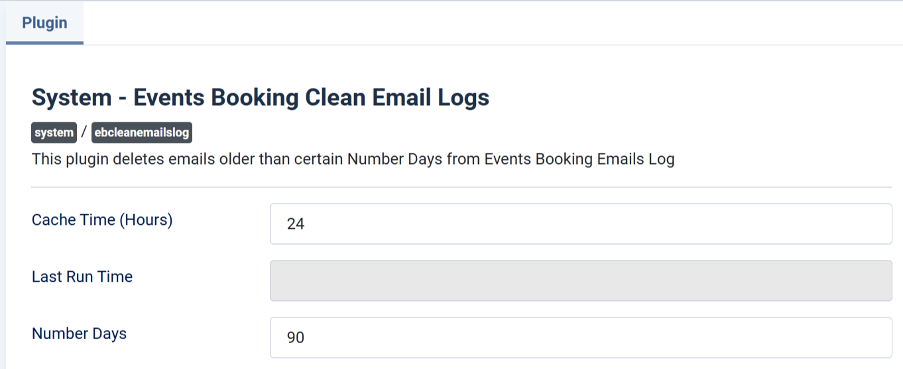

>>> This plugin was removed from version 5.0.7. Please use **[Events Booking - Clean Emails Log](/scheduled-tasks/clean-emails-log)** scheduled task instead.

When enabled, this plugin deletes email log entries older than the configured number of days. The default is 90 days. This reduces the space the email log uses in the database.

## Configure The Plugin
To have system send registrants to administrators email, you need to go to **System -> Plugins**, find and enable **System - Events Booking Clean Email Logs** plugin. It has following parameters, you can review and change it to suit your needs if needed

- **Number Days**: Enter Number Of Days you want to keep your emails in emails log.  If emails older than this configured Number Days, it will be deleted automatically by the plugin.

