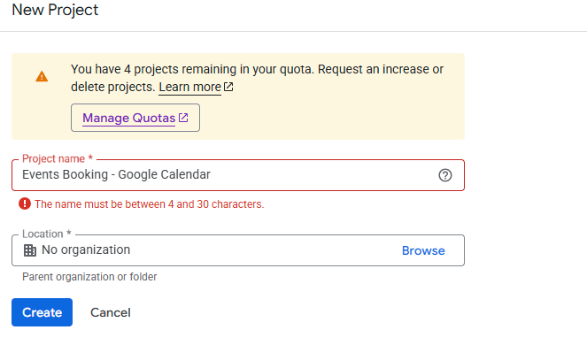
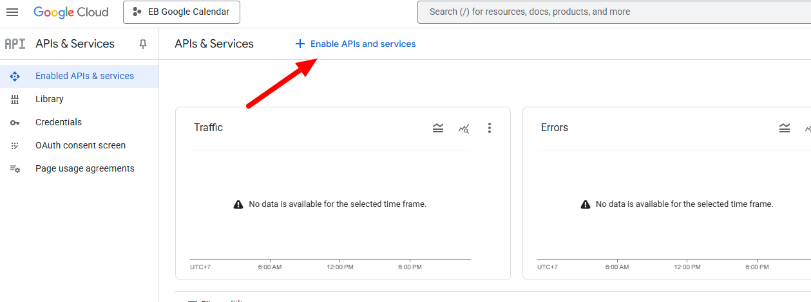
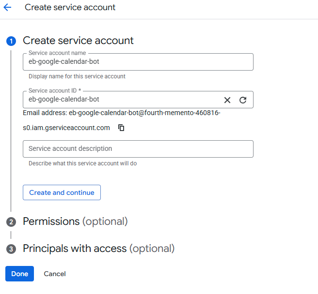
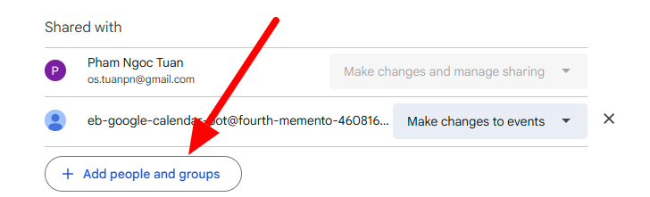
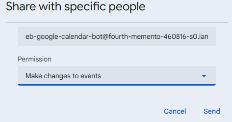
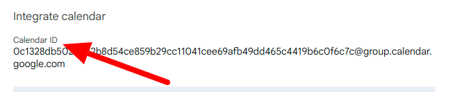
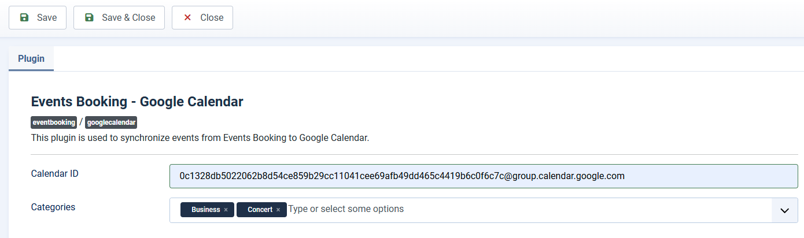
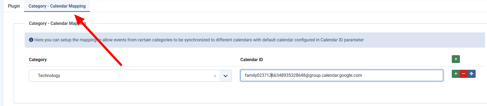

To synchronize Events Booking events with Google Calendar, go to System -> Plugins and enable **Events Booking - Google Calendar**. Then follow the steps below.

### Create a Google Cloud Project
1. Go to the [Google Cloud Console](https://console.cloud.google.com/).
2. Click **Select a project** → **New Project**.
3. Enter a name (e.g., `EB - Google Calendar`) and click **Create**.

### Enable the Google Calendar API

1. Access to the project, then click on  **Enable APIs and services**
2. Search for **Google Calendar API**.
3. Click **Google Calendar API** → **Enable**.

### Create a Service Account

1. Go to **IAM & Admin** > **Service Accounts**.
2. Click **+ CREATE SERVICE ACCOUNT** at the top.
3. Fill in the following:
   - **Service account name**: (e.g., `eb-google-calendar-bot`)
   - Click **Create and continue**.
4. In the **Grant this service account access to the project** step, skip assigning roles and click **Continue**, then **Done**.

### Create and Download a JSON Key File
1. Find your new service account in the list and click on its name.
2. Go to the **Keys** tab.
3. Click **Add Key** → **Create new key**.
4. Choose **JSON** format, then click **Create**.
5. A `.json` key file will be downloaded to your computer. **Keep this file safe!**
6. Rename the downloaded json file to be **service-account.json**, upload that file to **plugins/eventbooking/googlecalendar/credentials** folder on your site.

### Share Your Google Calendar with the Service Account
1. Open [Google Calendar](https://calendar.google.com/).
2. Hover over the calendar you want to use, click the three dots (⋮), and select **Settings and sharing**.
3. Scroll down to **Share with specific people or groups**.
4. Click **Add people** and enter your service account’s email (e.g., `joomla-calendar-bot@your-project.iam.gserviceaccount.com`).
5. Set permissions to **Make changes to events** and click **Send**.
6. Also, on this calendar **Settings and sharing** page, look for Calendar ID, copy that ID and store it somewhere. It is needed for the next step (enter that ID into Calendar ID parameter of Events Booking - Google Calendar plugin

### Configure Events Booking - Google Calendar plugin

1. Go to System -> Plugins, find and enable **Events Booking - Google Calendar** plugin
2. Click on the plugin to edit, there is a parameter called Calendar ID. Enter the Calendar ID which you saved in step #6 above into that parameter, save it.
3. By default, all events on your site will be synchronized to Google Calendar. If you want only events from certain categories will be synchronized, select the categories you want in the **Categories** parameter.
4. By default, all events will be synchronized to the calendar which you configured in **Calendar ID** parameter. If you want events from a category to be synchronized to a different calendar, look at **Category - Calendar Mapping** tab to set up the mapping between each category and the calendar you want to synchronize data to.

When you save a **published** event with both **Event Date** and **Event End Date** set, the plugin synchronizes it with the selected Google Calendar. It also synchronizes any child events.
