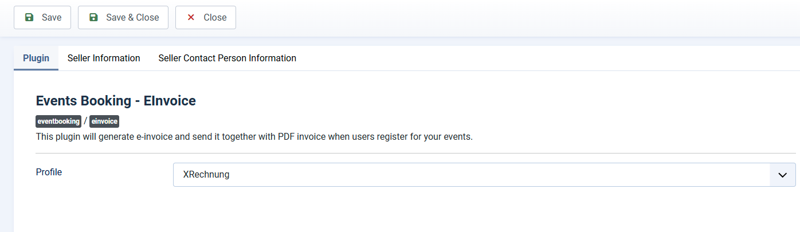
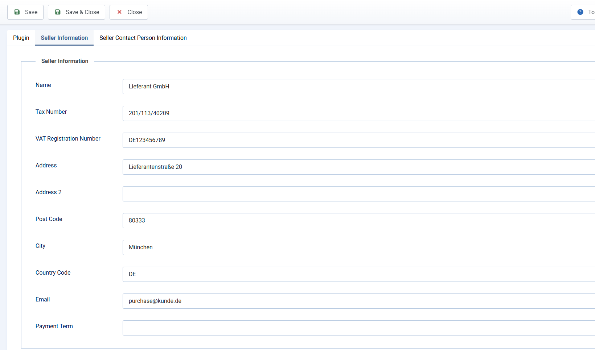
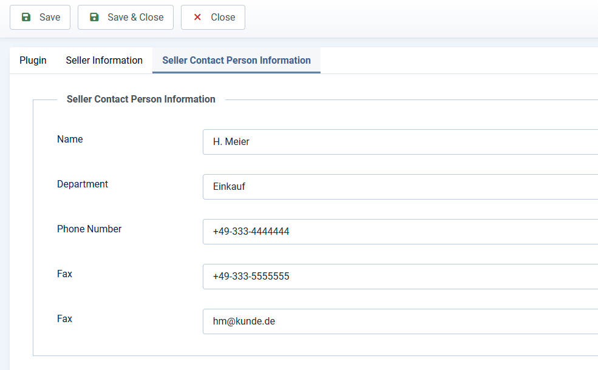

This plugin generates an electronic invoice alongside the standard Events Booking PDF invoice. When someone registers for an event, it creates an XML e-invoice in a format such as ZUGFeRD or XRechnung and emails it with the PDF invoice to the administrator and the registrant.

If you are using Events Booking in a country which requires e-invoices, please purchase the plugin at [https://joomdonation.com/joomla-extensions/events-booking-joomla-events-registration.html](https://joomdonation.com/joomla-extensions/events-booking-joomla-events-registration.html) (look at Paid Add-ons tab), install, and enable **Events Booking - EInvoice** plugin.

After installing the plugin, please go to System -> Plugins, find the plugin **Events Booking - EInvoice** , click on it to edit, enter necessary parameters below before enabling to have it works properly

### Basic Information

**Profile**: As of right now, the plugin supports two profiles **EN 16931 (COMFORT) profile** and **XRechnung**. Please choose to use the the profile required for your country.

### Seller Information
On this tab, you provide seller information use to generate invoice such as **Name**, **Tax Number**, **VAT Registration Number**, **Address**...Honestly, I do not understand the law of your country enough to know exactly what information is required, so please provide the information you need there.

### Seller Contact Person Information

On this tab, you provide the contact person of your country Like **Name**, **Departement**, **Address**, **Email**... Like the Seller Information above, I also do not know exactly what information required, so please provide the information you want/you can there (I guess this data could be optional, but I do not really know)

After entering all necessary information, you can enable the plugin. And now, each time the PDF invoice is generated, the xml invoice will be generated and sent to the administrator and the registrant email as well.

>>> If you use Events Booking 5.0.7 or earlier, please make sure accessing to My Downloads menu item on our website, download latest package of Events Booking from there and update it to your site. This plugin requires Events Booking 5.0.8+ (or 5.0.7 installed after 18 June 2025 to work)