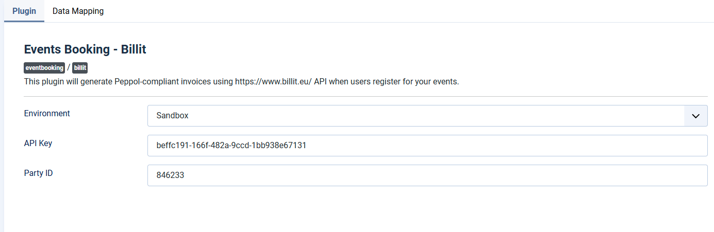

This plugin uses the Billit API (https://www.billit.eu/) to generate Peppol-compliant invoices. After a registration payment succeeds, it sends the registration and payment details to Billit, which creates an invoice in your account.

If you are using Events Booking in a country which requires Peppol invoices, please purchase the plugin at https://joomdonation.com/joomla-extensions/events-booking-joomla-events-registration.html (look at Paid Add-ons tab), install, and enable **Events Booking - Billit** plugin.

After installing the plugin, please go to System -> Plugins, find the plugin Events Booking - Billit , click on it to edit, enter necessary parameters below before enabling to have it works properly

## Basic Information

Follow instructions at [https://docs.billit.be/docs/partyid-and-key](https://docs.billit.be/docs/partyid-and-key), find API Key and Party ID of your Billit account, enter it into plugin parameter. Also, set **Environment** to paramter to Sandbox or Live.

## Data Mapping

Beside basic data such as First Name, Last Name, Address...., Billts also requires VAT Number and Street Number of registrants. You will need to create custom fields to collect these data and then choose these fields in Data Mapping parameters so that the plugin knows where to get data for VAT Number and Street Address.

After these basic setup, the plugin will be ready to use.

