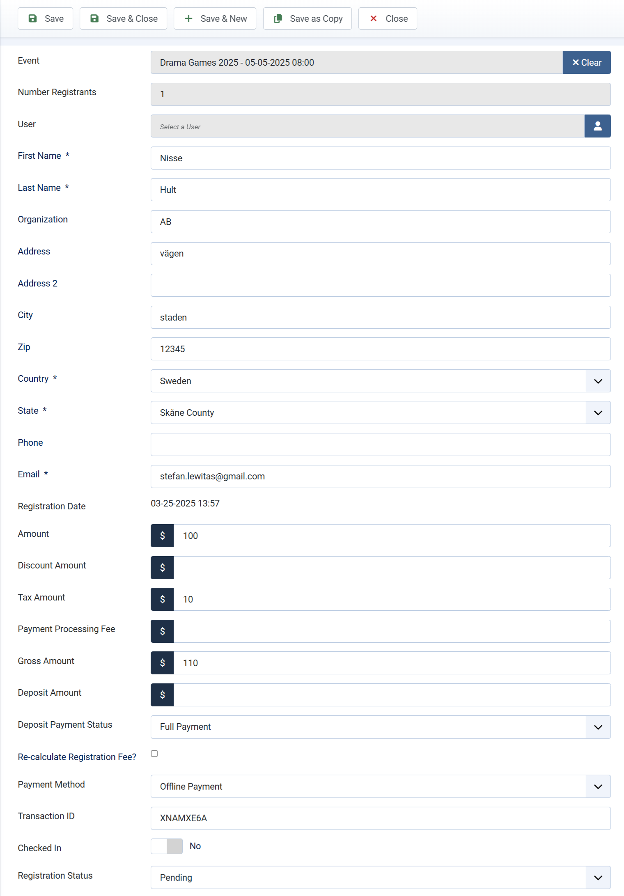

## Add New Registration
To add a registration manually, such as when someone registers by phone, open the registrants management screen. Select the event from the events filter and click **New** in the toolbar. Enter the registration details in the form.

1. When add new registration record, you can choose an existing user and the system will try to fill-in the form fields auto-manatically from the data stored in his profile
2. If you fill-in a number greater than 1 (mean you are adding a group registration records) into **number registrants** field, you can only add information of group members after saving the registration record.
3. You can leave the amount inputs (Total Amount, Discount Amount, Tax Amount, Amount) empty and the system will calculate it automatically.

## Edit existing registration record
To update a registration, open the record on the registrants management screen. You can also select its checkbox and click Edit in the toolbar. Update the details in the form that opens.
1. If the record you are editing is a group registration record, you can click the **Remove** button next to each group member to remove that member from group
2. If you update information of the record which change the registration fee (For example, change value of a custom fee field, remove group members), please check on **Recalcualte Registration Fee** checkbox before pressing save so that the registration fee will be updated with new information

