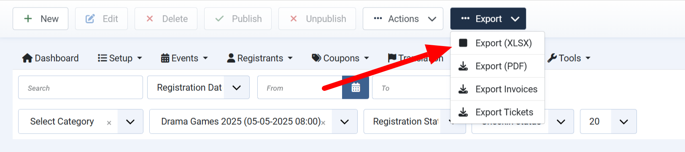
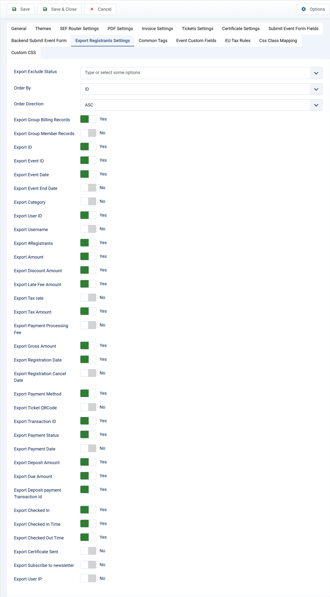
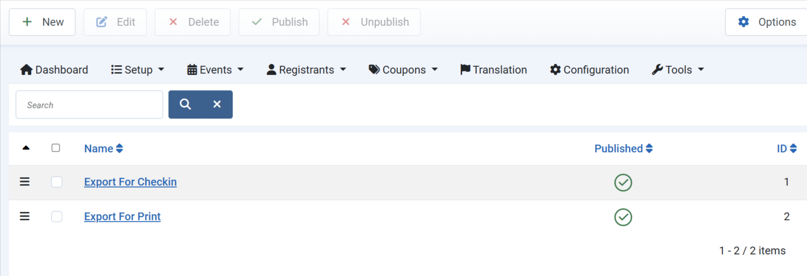
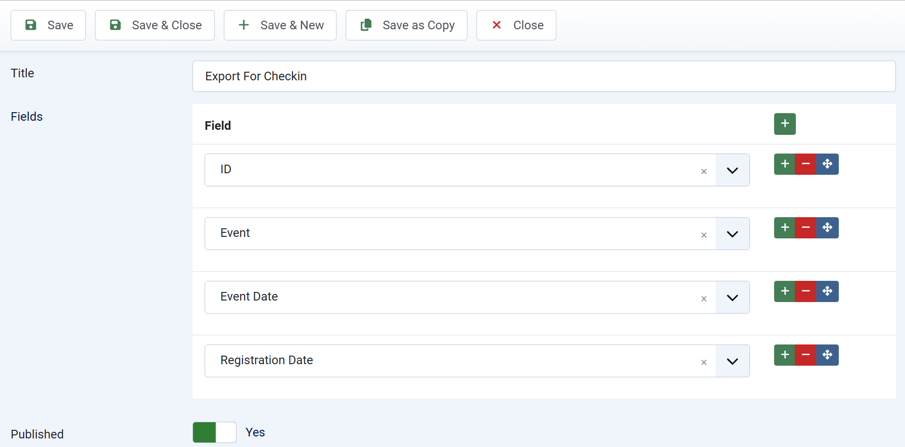
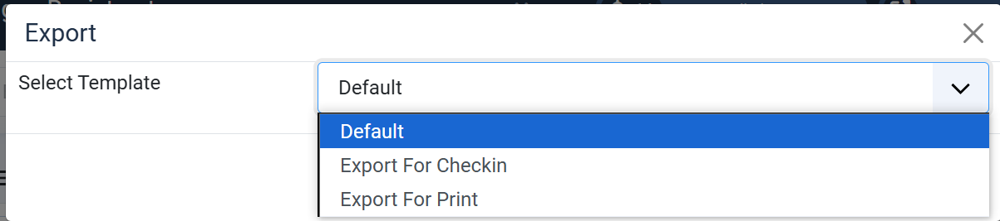

Use **Actions -> Export (XLSX)** in the Registrants Management toolbar to export registrants to an Excel (XLSX) file. Select an event to export its registrants, or leave the event filter blank to include all events. Only records that match the active filters are exported.

- To export registrants for one event, select it in the Events filter.
- To export registrants with a particular status, select Pending, Paid, or Cancelled in the Status filter.
- To export registrants by check-in status, select Checked-in or not Checked-in in the Checked in filter.
- You can also choose date range, enter keyword in the search box to find registrants you want before export

## Choose Type Of Records To Export
If you use group registration, review these two options under **Events Booking** -> **Configuration** on the **Export Registrants Settings** tab.

1. Set **Export Group Billing Records** to **Yes** to include group billing records in the Excel file, or **No** to exclude them.
2. Set **Export Group Member Records** to **Yes** to include group member records in the Excel file, or **No** to exclude them.

## Choose Data/Columns For The Export

1. To exclude a custom field, go to **Events Booking** -> **Setup** -> **Custom Fields**, edit the field, and set **Hide On Export** to **Yes**.

2. For other fields, You can also choose to include/exclude fields you want. Go to **Events Booking -> Configuration**, look at  **Export Registrants Settings** tab, and change settings to suit your needs.

## Export Templates
You can create export templates with different fields and field orders. For each Excel export, choose a custom template or use Default Template to apply the settings above.

### Setup Export Templates

In the administrator area, go to Events Booking -> **Setup** -> **Export Templates**. Create as many templates as you need and choose which fields to include and in what order.

### Choose Export Template To Export Registrants
When you export registrants, Events Booking prompts you to choose a template. Select the Default export template or one of the templates you created.

