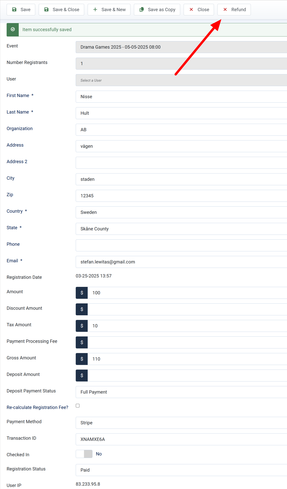

Administrators can issue registration refunds from the Joomla administrator area. The following payment plugins support refunds.

- PayPal
- PayPal Pro
- Stripe
- Stripe Checkout
- Square Card
- Mollie

If the registrant paid using one of these plugins, follow these steps to issue a refund.

- Go to Events Booking -> Registrants
- Click on the registration record you want to refund 
- Click on the Refund button in the toolbar to process refund

