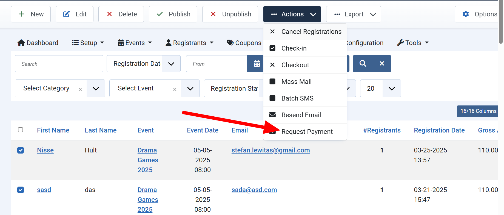

Use this feature to email a payment request to registrants who have an unpaid registration. This is useful in the following situations.

- A registrant chose Offline payment and now wants to pay online, for example through PayPal or Stripe.
- A registrant chose to pay online, but the payment failed. Send a payment request so they can complete payment from the link in the email without registering again.

If you need to use this feature:

- Go to **Events Booking -> Registrants** and select the checkbox next to the registration you want to request payment for.
- And click **Action -> Request Payment** in the toolbar.

The registrant receives an email with a link to pay for the registration. They can follow the link and complete the payment to become an active registrant.

You should go to **Events Booking -> Emails & Messages**, find and change the subject and body of the email will be sent when you use this **Request Payment** feature:

- **Payment Request Email Subject For Pending Registration**: Subject of the email will be sent in case the current registration is Pending (for example, registrants who use offline payment or failed payment)
- **Request Payment Email Body For Pending Registration**: Body of the email which will be sent in case the current registration is Pending

- **Payment Request Email Subject**: Subject of the email will be sent in case the current registration is not Pending (for example, the registrant is in waiting list and you want them to make payment to become real registrant)
- **Request Payment Email Body**: Body of the email which will be sent in case the registrant is not Pending.

In case the registrant uses deposit payment and haven't completed the remaining payment yet, the system will send [Remaining Payment Reminder Email](/email-tags/deposit-payment-reminder-email) instead.

>>> You will have to set **Activate Waiting List Feature**  config option to **Yes** or have Pending Registration Records in the system to see this **Request Payment** button.

