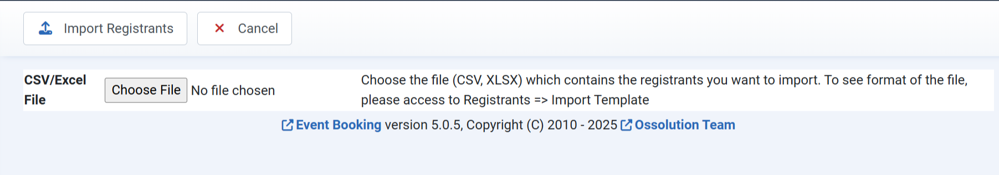

Events Booking allows you to import registrants from an Excel or CSV file. This can be used for two purposes:

1. **Update existing registration data**: You can export your current registrants data into CSV/Excel file, make the change in the exported file, then import it back into the system to hae the modified data updated
2. **Import registrants data** which is collected from outside of Events Booking into the system (for example, you might want to migrate data from other systems into Events Booking)

## Prepare Registrants Data
Prepare the registrant data using the Events Booking import template. Log in to your site’s administrator area, open Events Booking, and go to **Registrants -> Import Template** (https://domain.com/administrator/index.php?option=com_eventbooking&task=registrant.import_template - replace https://domain.com with your site URL).

Events Booking generates an **Import Template** based on your site settings. See [sample_import_template.xlsx](sample_import_template.xlsx) for an example. Prepare your data in that format. You can test the import with a few sample records first.

1. To update an existing registration, enter its ID in the **id** column. Leave the cell blank to create a registration. Events Booking updates a matching record and creates one if no match exists. If all records are new, you can remove the entire column.
2. The **event_id** column must contain ID of the event, not title of the event.
3. Enter the date of registration in the **register_date** column. Use the format set in Date Format under Events Booking -> Configuration.
4. The **payment_method** columns must contain name of payment method such as os_paypal, os_offline, os_authnet, not payment method title
5. The **published** column must contains number, not text. 0 => Pending, 1 => Paid, 2 => Cancelled, 3 => Waiting List

## Import Registrants

After preparing the file, go to **Registrants** -> **Import** from any Events Booking page. Select the file and click **Import Registrants** in the toolbar. When the import finishes, check how many records Events Booking imported and verify the data.

