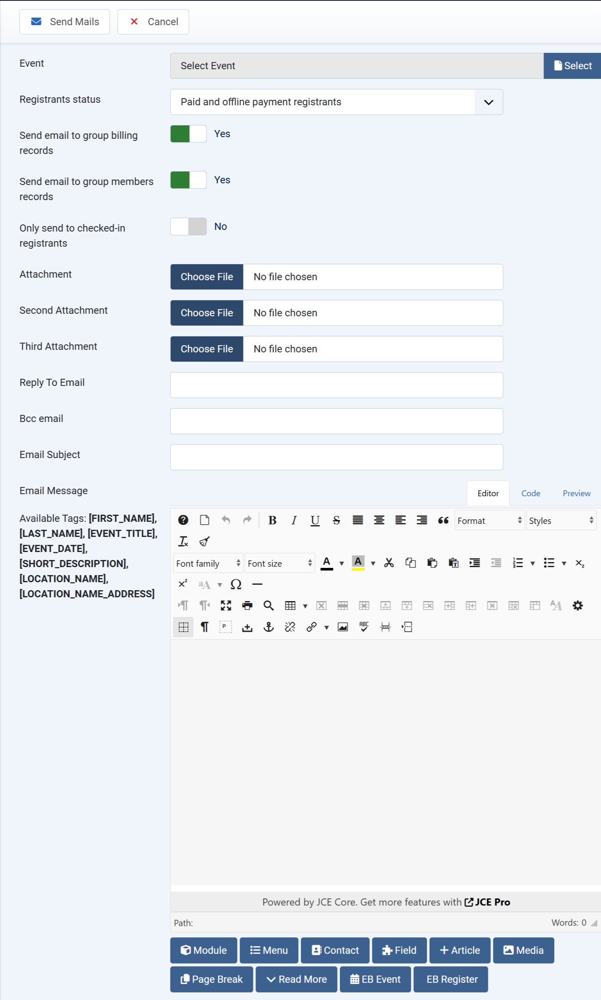

To email all registrants for an event, go to **Components -> Events Booking -> Mass Mail**. The form has the following settings.

1. **Event**: Select the event whose registrants should receive the email.
2. **Registrant Status**: Choose a status here and only registrants have that status will receive email
3. **Send email to group billing records**: For group registrations, choose whether to email the billing contact.
4. **Send email to group members records**: For group registrations, choose whether to email each group member.
5. **Only send to checked-in registrants**: If you enable the Checkin Registrants feature, use this setting to limit the email to registrants who have checked in.
6. **Attachment**, **Second Attachment**, **Third Attachment**: Attach up to three files.
7. **Reply To Email**: Allow you to configure Reply-To email 
8. **Bcc Email**: Enter an address that should receive a copy of each email.
9. **Email Subject**: Enter subject of the email
10. **Email Message**: Enter body of the email

Complete the form and click **Send Mails** in the toolbar to email the registrants who match the filters.

