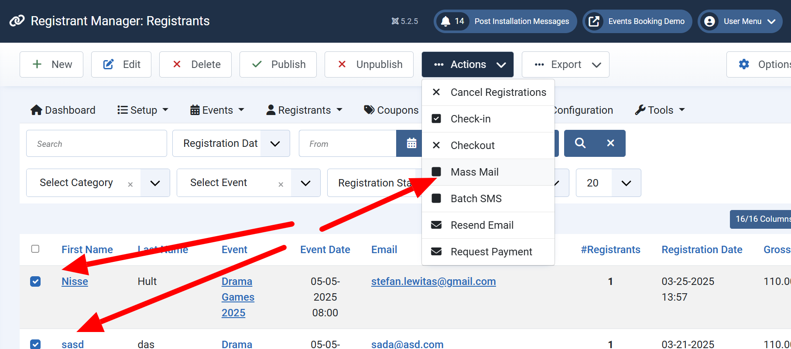
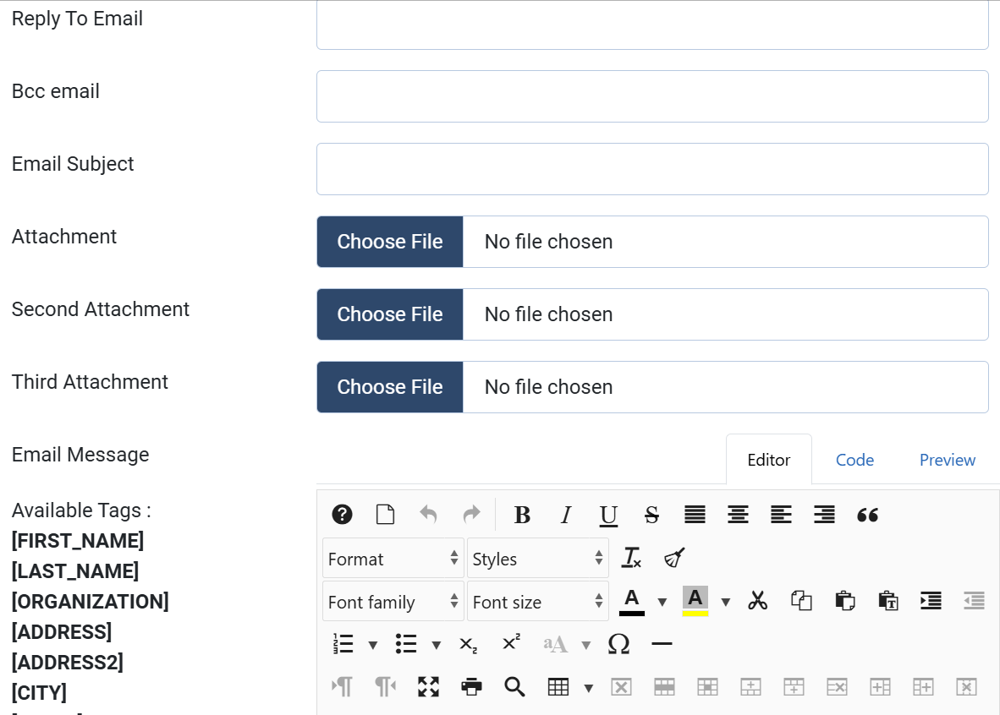

To email selected registrants, follow these steps on the Registrants Management screen.

1. Select the checkboxes next to the registrants you want to email.
2. Click Mass Mail in the toolbar. A popup opens where you can compose the email.
3. Enter Email Subject, Email Message, upload attachments and other (optional information) in the form.
4. You can use the following tags in the email message: **[EVENT_TITLE]**, **[EVENT_DATE]**, **[EVENT_END_DATE]**, **[SHORT_DESCRIPTION]**, **[DESCRIPTION]**, **[FIRST_NAME]**, **[LAST_NAME]**, **[REGISTRATION_DETAIL]**, **[DOWNLOAD_CERTIFICATE_LINK]**
5. Press Process button at the bottom to send email

**Mass Mail button**

**Mass Mail form**
