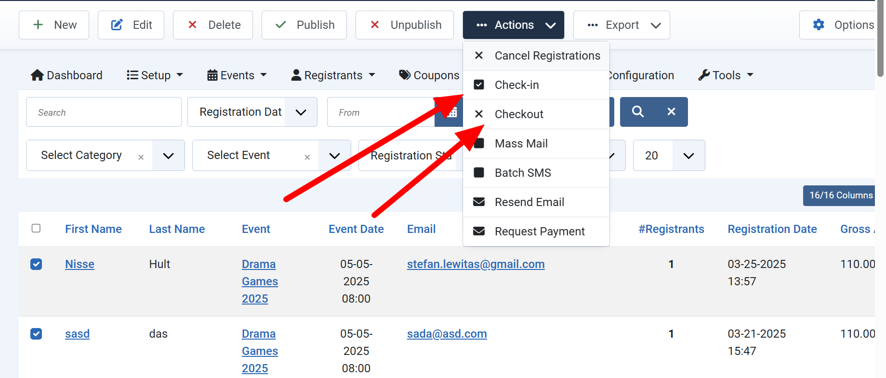
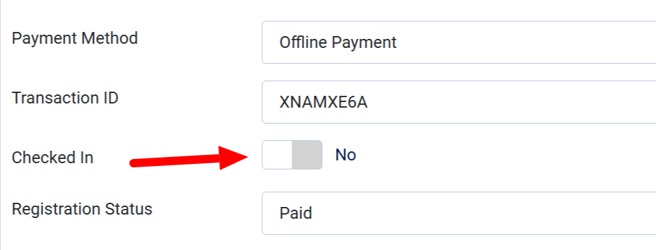

Events Booking supports two ways to check registrants in and out.

1. Check-in registrants using a QR code.
3. Check-in registrants manually.

To check registrants in or out manually, first enable the feature. Go to **Events Booking** -> **Configuration** and set **Activate Checkin Registrants** to **Yes**. This setting is off by default.

## Checkin registrants
To check-in registrants, there are two ways:

1. On Registrants Management screen, select the checkbox next to registrants you want to check-in, then click **Actions -> Check-in** in the toolbar
2. Or you can click on a registration record to view the information, then set **Checked In** to **Yes**

## Checkout Registrants

Similar to check-in, there are two ways to check out registrants:
1. On Registrants Management screen, select the checkbox next to registrants you want to checkout, then click **Actions -> Checkout** in the toolbar.
2. Or you can click on a registration record to view the information, then set **Checked In** to **No**

