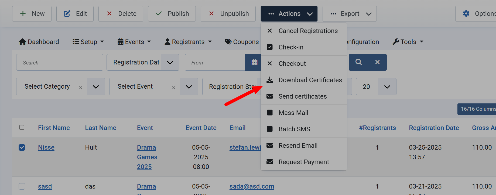

If you use the [Certificates Feature](/advanced-features/certificates), you can download PDF certificates for selected registrations from the Registrants Management screen.

- Select the checkbox next to the registration records which you want to download certificate
- Press **Actions -> Download Certificates** button in the toolbar.

Events Booking combines the selected certificates into one PDF and downloads it to your computer. For example, you can print the certificates and send them to your registrants.

