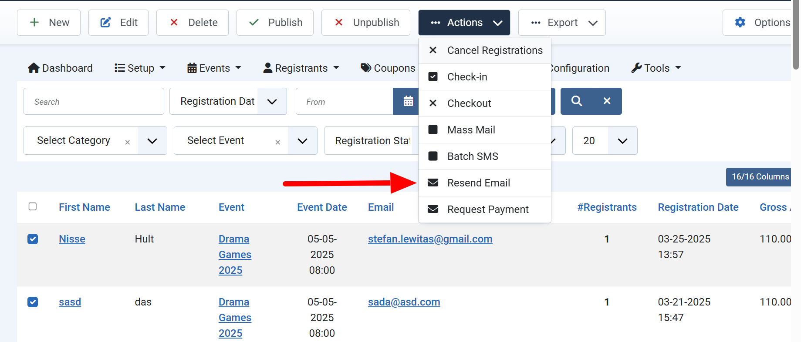

If a registrant missed the confirmation email or you updated their registration details, you can resend the email.

1. Access to Registrants Management screen.
2. Select the checkboxes next to the registrants who should receive the email again.
3. Press **Actions -> Resend Email** button in the toolbar to resend the confirmation email.

Events Booking resends the confirmation email to the registrants and the notification email to the administrator.

